# MiBici · Equipo 29

<a target="_blank" href="https://cookiecutter-data-science.drivendata.org/">
    
</a>

Diseñar, como equipo, una propuesta de solución de Machine Learning para un conjunto de preguntas sobre el sistema de bicicleta pública MiBici, que combine modelos de regresión, clasificación y clustering.

## Preguntas del proyecto

| # | Pregunta de negocio | Tarea | Planteamiento del equipo | Código |
| --- | --- | --- | --- | --- |
| P1 | ¿Cuántos viajes se iniciarán en una estación o zona en un periodo futuro? | Regresión | Salidas de cada estación el día D, pronosticadas a las 23:00 de D-1 (estación-día, horizonte de un día). | `mibici/features.py`, `mibici/modeling/train_p1.py` |
| P2 | ¿Una estación estará en riesgo de quedarse sin bicicletas o sin anclajes disponibles en un periodo futuro? | Clasificación | Riesgo por estación y hora, aproximado con la ocupación estimada a partir de los viajes y la capacidad. | `mibici/features_p2.py`, `mibici/modeling/train_p2.py` |
| P3 | ¿Qué grupos de estaciones comparten patrones de uso y dónde se ubican en la ciudad? | Clustering | Grupos de estaciones con perfiles de uso parecidos y su ubicación. | `mibici/features_p3.py`, `mibici/modeling/train_p3.py` |

Los ML Canvas de cada pregunta están en `references/`.

## Datos

- Fuente: [Datos abiertos MiBici](https://mibici.net/es/datos-abiertos/): viajes mensuales (`datos_abiertos_AAAA_MM.csv`) y nomenclatura de estaciones (`nomenclatura_AAAA_MM.csv`). Las condiciones de uso son las publicadas en ese portal.
- Rango acordado: enero de 2025 a septiembre de 2026 (21 meses) y la nomenclatura 2026-09; 7,894,097 viajes.
- Versión: `references/manifiesto_datos_p2.json` guarda el SHA256 y el número de registros de cada archivo; su campo `version` (`66dd3d190bba`) se registra en cada run de MLflow como `data_version`. Para regenerarlo después de la descarga: `python -m mibici.manifiesto_p2`.
- Privacidad: `data/` no se versiona. Cada pregunta lee sólo las columnas que necesita (P1: `Inicio_del_viaje` y `Origen_Id`) y en MLflow sólo se registran métricas agregadas, nunca columnas de usuario.

## Instalación

Requiere Python 3.14 (`requires-python = "~=3.14.0"`). Desde la raíz del repositorio:

```bash
python -m venv .venv
.venv\Scripts\activate          # Windows; en Linux o macOS: source .venv/bin/activate
pip install -r requirements.txt
```

`requirements.txt` fija las versiones de todas las dependencias e instala el paquete `mibici` en modo editable.

## Descarga de datos abiertos

Para descargar los CSV mensuales publicados en [Datos abiertos MiBici](https://mibici.net/es/datos-abiertos/) y cargar cada archivo como un DataFrame independiente:

```python
from mibici.dataset import (
    download_and_load_datasets,
    download_and_load_latest_nomenclature,
    merge_dataset_define_nomenclature,
)

datasets = download_and_load_datasets()
enero_2025 = datasets["datos_abiertos_2025_01"]
nomenclature = download_and_load_latest_nomenclature()
all_trips = merge_dataset_define_nomenclature(datasets, nomenclature)

# Opcional: reemplaza el rango configurado para esta llamada
datasets = download_and_load_datasets(
    start_year=2023,
    start_month=12,
    end_year=2024,
    end_month=1,
)
```

El rango inclusivo predeterminado se define en `CONFIG` dentro de `mibici/config.py` mediante `download_data_start_year`, `download_data_start_month`, `download_data_end_year` y `download_data_end_month`. Actualmente cubre de enero de 2025 a septiembre de 2026, el rango acordado por el equipo. Los archivos originales se guardan en `data/raw/`. `datasets` es un diccionario cuyas claves son los nombres de archivo sin `.csv` y cuyos valores son los DataFrames mensuales. `nomenclature` contiene el DataFrame separado de la nomenclatura más reciente publicada; su CSV se guarda también en `data/raw/` con su nombre original. La función busca el año y mes más recientes enlazados en la página, independientemente del rango de viajes configurado. Al cargar cada CSV se normalizan los nombres de columnas (espacios, comillas y acentos) para que coincidan entre meses. `merge_dataset_define_nomenclature` concatena los DataFrames mensuales, convierte `Inicio_del_viaje` y `Fin_del_viaje` a fechas y devuelve un único DataFrame con las columnas de nombre, latitud, longitud y capacidad para origen y destino; conserva también `Origen_Id` y `Destino_Id`. También se puede ejecutar `python -m mibici.dataset` para descargar el rango configurado, la nomenclatura más reciente, combinarlos, registrar sus dimensiones y guardar el resultado en `data/processed/combined_dataset.parquet` (la carpeta se crea si no existe).

Para reemplazar el rango desde la línea de comandos, especifica los cuatro valores:

```powershell
python -m mibici.dataset --start-year 2024 --start-month 12 --end-year 2025 --end-month 1
```

El rango incluye los meses inicial y final. Si omites las opciones, se usa el rango de `mibici/config.py`. Debes proporcionar los cuatro valores juntos; los meses deben estar entre 1 y 12 y el inicio no puede ser posterior al final.

## MLflow Project

El `MLproject` de la raíz define dos entry points. El entorno usa las dependencias de `requirements.txt`; los defaults de rutas, fechas, semillas y parámetros del modelo se leen desde `mibici/config.py`:

```powershell
$raiz = (Resolve-Path .).Path.Replace('\', '/')
$env:MIBICI_TRACKING_URI = "sqlite:///$raiz/mlflow.db"
$env:MLFLOW_TRACKING_URI = $env:MIBICI_TRACKING_URI
mlflow run . -e ingest --env-manager local
mlflow run . -e train -P question=p1 -P model=auto -P 'hyperparameters={}' --env-manager local
mlflow run . -e train -P question=p2 -P model=hist_gradient_boosting -P hyperparameters=max_iter=300,max_leaf_nodes=63 --env-manager local
mlflow run . -e train -P question=p3 -P model=seleccion --env-manager local
```

Ejecuta `ingest` antes de `train`: descarga y combina los datos y después genera el manifiesto común de versión en `references/manifiesto_datos_p2.json`. El entry point `train` genera las features del problema indicado (`p1`, `p2` o `p3`) y después llama su entrenador configurado. Los modelos disponibles actualmente son P1 `auto`, `poisson`, `hgb_poisson` y `hgb_absoluto`; P2 `hist_gradient_boosting`; y P3 `kmeans_geo`, `kmeans_uso`, `gmm_uso` y `seleccion` (flujo completo, ver la sección de P3). `auto` usa la selección configurada para P1. `hyperparameters` acepta pares separados por coma: P1 Poisson admite `alpha`; P1 HGB Poisson, HGB absoluto y P2 admiten `learning_rate`, `max_leaf_nodes`, `max_iter` y `l2_regularization`; P3 admite `k` y `n_init` (`kmeans_geo` y `kmeans_uso`), `n_components`, `covariance_type` y `n_init` (`gmm_uso`), o `buscar=1` para la búsqueda con runs anidados. Por ejemplo, Random Forest y `n_estimators` no son compatibles como opciones individuales del entry point.

Los ejemplos incluyen `--env-manager local` para reutilizar el entorno virtual activo. Si no vas a usar un entorno virtual ya activado y quieres que MLflow gestione el entorno del proyecto, puedes omitir esa opción. La corrida de verificación del cierre se hizo con `--env-manager local`, en un entorno existente con Python 3.14.8 y las versiones fijas de `requirements.txt`. Sin esa opción, MLflow crea el entorno de `python_env.yaml` con virtualenv y pyenv; ese camino no se probó.

La sensibilidad de P2 a la ocupación inicial (niveles 0.3 y 0.7, además de 0.5) no está expuesta como parámetro del `MLproject`: `train` con `question=p2` o `question=all` solo corre el nivel 0.5. Esa comparación se corre con `python -m mibici.modeling.train_p2 --niveles 0.5 0.3 0.7`. Si el almacén lo creó el servidor de tracking, agrega `--tracking-uri http://127.0.0.1:5000` con el servidor encendido, porque sus artefactos usan direcciones `mlflow-artifacts:/` que solo resuelve el servidor.


El almacén del proyecto se elige con `MIBICI_TRACKING_URI`; si no está definida, se usa una URI SQLite absoluta a `mlflow.db` en la raíz del repositorio. Las rutas SQLite relativas de esa variable se resuelven contra la raíz del repositorio, independientemente del directorio desde el que se invoque. MLflow inyecta `MLFLOW_TRACKING_URI` en sus subprocesos incluso sin una elección explícita del usuario; por ello su presencia no sustituye esta configuración del proyecto.

Antes de `mlflow run`, desde la raíz del repositorio, configura ambas variables con la misma URI absoluta para que el run exterior y los entrenamientos usen el mismo almacén:

```powershell
$raiz = (Resolve-Path .).Path.Replace('\', '/')
$env:MIBICI_TRACKING_URI = "sqlite:///$raiz/mlflow.db"
$env:MLFLOW_TRACKING_URI = $env:MIBICI_TRACKING_URI
mlflow run . -e train -P question=all -P 'hyperparameters={}' --env-manager local
```

`question=all` ejecuta P1 con `auto`, P2 con su modelo configurado y P3 con `seleccion`; no acepta un modelo ni hiperparámetros compartidos. El entry point comprueba la URI inyectada del run exterior antes de entrenar: si difiere del almacén elegido o sigue siendo una ruta SQLite relativa ambigua, detiene la ejecución y pide configurar ambas variables antes de relanzar. Cambiar el almacén dentro del subproceso no puede trasladar un run exterior ya creado. En una invocación directa sin run exterior, el almacén del proyecto prevalece sobre un `MLFLOW_TRACKING_URI` incidental. Al terminar, el despachador restaura el entorno previo.

`combined_dataset.parquet` es la entrada común de las tres preguntas: conserva todos los viajes y sus identificadores (`Viaje_Id`, `Origen_Id`, `Destino_Id`). Cada pregunta aplica después sus propios filtros.

## Configuración

`mibici/config.py` reúne los parámetros de los experimentos:

| Bloque | Contenido |
| --- | --- |
| `CONFIG` | Carpetas de datos, nombre del parquet combinado y rango de meses de la descarga. |
| `CONFIG_P1` | Ruta del panel y del manifiesto, hora de emisión y retraso del conteo, cortes temporales, semilla, rejillas de Poisson y HistGradientBoosting, experimento y almacén de MLflow. |
| `CONFIG_P2` | Cortes temporales, umbrales de riesgo, horizonte, limpieza de viajes, semilla, rejilla de HistGradientBoosting, experimento y almacén de MLflow de P2. |
| `CONFIG_P3` | Fechas, franjas, umbrales, semilla, valores de k y MLflow de P3. |

Se quedan en su módulo las constantes internas que forman parte de la definición del código: columnas que lee cada pregunta, nombres de variables, rezagos y ventanas de P1 (los nombres `lag_7`, `media_28d`, ... dependen de ellos) y el umbral de fechas ilegibles al cargar. Todos los parámetros que cambian un run (rango de fechas, versión de datos, semilla e hiperparámetros) se registran además en MLflow.

### Transformaciones compartidas

`mibici/features_pipeline.py` centraliza la construcción de pipelines tabulares de scikit-learn y un helper para ajustar transformadores exclusivamente con el conjunto de entrenamiento. No centraliza la creación de variables ni impone las mismas transformaciones a todas las preguntas: cada tarea conserva sus columnas, etiquetas y decisiones de modelado.

- P1 usa el constructor compartido para la regresión de Poisson: aplica `log1p` y escalado a los conteos, codifica el día de la semana y deja pasar las variables binarias. HistGradientBoosting recibe sus features directamente, pues maneja el día como categórico y no necesita esa transformación.
- P2 lo usa para la regresión logística (imputación y escalado numérico, one-hot para hora y día) y Random Forest (imputación). HistGradientBoosting continúa recibiendo las variables originales, ya que no requiere escalado y maneja valores faltantes.
- P3 usa el helper de ajuste train-only para escalar el espacio de uso que alimenta las métricas. El baseline geográfico usa coordenadas en kilómetros; los modelos de uso conservan sus pipelines de selección por VIF, escalado y clustering sobre variables de uso.

Al añadir un modelo, elige transformaciones según el algoritmo y el significado de sus features. Ajusta imputadores, escaladores y codificadores solo con `fit`/`fit_transform` sobre train; usa luego `transform` en validación, prueba y producción. Mantén juntas las transformaciones y el estimador en un `Pipeline` cuando formen parte de la predicción, para evitar diferencias entre entrenamiento e inferencia. No escales por defecto modelos de árboles ni apliques transformaciones pensadas para otro problema.

## Experimento base

### P1 · demanda diaria por estación

```powershell
mlflow run . -e ingest --env-manager local
mlflow run . -e train -P question=p1 -P model=auto -P 'hyperparameters={}' --env-manager local
```

1. `mibici.dataset` descarga los 21 meses y la nomenclatura y guarda `data/processed/combined_dataset.parquet`.
2. `mibici.features` construye el panel estación-día de salidas en `data/interim/p1_panel_diario.parquet` y su resumen `p1_panel_diario.json`.
3. `mibici.modeling.train_p1` entrena los baselines (semana previa y persistencia) y tres candidatas: la regresión de Poisson regularizada (`poisson`), HistGradientBoosting con pérdida de Poisson (`hgb_poisson`) y HistGradientBoosting con pérdida absoluta (`hgb_absoluto`). Las dos de HistGradientBoosting recorren la misma rejilla, así que entre ellas sólo cambia la pérdida: la de Poisson estima la media de un conteo y la absoluta la mediana, que es lo que minimiza el MAE con el que se elige. La búsqueda registra un run padre por candidata y un hijo anidado por cada combinación de hiperparámetros; después registra las candidatas finales y sus artefactos. Con `mlflow run`, `-P model=` también acepta `hgb_absoluto`, con los mismos hiperparámetros que `hgb_poisson`.

Partición por fecha objetivo: FIT hasta 2026-02-27, VAL de 2026-03-01 a 2026-04-29, entrenamiento final con las filas elegibles hasta 2026-04-29 y TEST de 2026-05-01 a 2026-09-30. Las variables usan información hasta D-2 porque el día D-1 aún no cierra al emitir el pronóstico. Los cortes, la semilla (29), las rejillas de hiperparámetros y las rutas de P1 están en `CONFIG_P1` de `mibici/config.py`.

Cada hiperparámetro se elige por menor `val_mae`, sin consultar prueba. La selección parte de la baseline de semana previa y sólo la reemplaza una candidata que también cumpla la política de dominio descrita abajo; si dos empatan, se queda la primera en el orden `poisson`, `hgb_poisson`, `hgb_absoluto`. Persistencia se mide y se registra como baseline, pero no es elegible para sustituir a semana previa bajo la política vigente. Cambiar esa elegibilidad requiere una decisión del equipo, no sólo una diferencia numérica observada en prueba.

#### Politica de dominio para esta iteracion

Antes de comparar MAE, una candidata solo es elegible si todas sus predicciones de validacion son numericas, finitas y mayores o iguales a cero, como corresponde a una demanda de viajes. La seleccion conserva la regla de menor `val_mae` y no consulta prueba. La candidata que no cumpla el dominio conserva su run, metricas y artefactos; no se recorta su salida ni se ajusta de nuevo.

Esta regla se introdujo despues de la auditoria local en la que ya se habian observado resultados de prueba. Por tanto, esta iteracion no se presenta como una evaluacion con prueba intacta. La regla se aplica exclusivamente con validacion y no autoriza a retocar modelos o hiperparametros usando prueba.

Cada candidata registra `val_pred_min` cuando existe al menos una prediccion finita, los conteos de negativos y no finitos y `val_domain_eligible`, ademas de etiquetas con el motivo de elegibilidad. Las tres candidatas siguen visibles y comparables aunque alguna sea inelegible. El humo de la version inmutable exige una prediccion numerica, finita y no negativa antes de mover el alias.

El Registry solo puede mover `champion` en una ejecucion `model=auto`, despues de comparar las candidatas. Una ejecucion individual registra evidencia pero no promueve. Si no hay candidatas elegibles, no se promueve ninguna y se conserva el campeon previo.

#### Tracking avanzado y Registry de P1

- Los runs llevan `question`, `team`, `author`, `data_range`, `seed`, `data_version`, `git_commit`, `git_dirty`, `model_family` y `stage_of_work`; esta última distingue `baseline`, `search` y `candidate`.
- Con `model=auto`, las rejillas configuradas producen cinco hijos de búsqueda para Poisson y tres para cada HistGradientBoosting (once en total), y tres runs `candidate` con artefactos completos, uno por candidata.
- Cada candidato final guarda el modelo en formato skops mediante `log_model`, con firma y ejemplo de entrada. También registra muestras acotadas de entrenamiento, validación y prueba mediante `log_input`; se guardan esquema, perfil, digest, versión y número total de filas, no las tablas completas.
- Los artefactos se organizan en `plots/` (real contra pronóstico y, en cada candidata, residuales de prueba), `data/` (manifiesto, resumen y, cuando aplica, coeficientes) y `config/` (configuración y rejilla). `p1_resultados.json` conserva la comparación de baselines y candidatos.
- Diagnóstico de prueba del modelo ya elegido, sin intervenir en la selección ni en los hiperparámetros: cada run final registra `test_mae_AAAA_MM` de mayo a septiembre de 2026 y `test_mae_mensual_desv` (desviación del MAE entre meses), y cada candidata guarda `plots/p1_residuales_<candidata>.png` con los residuales (pronóstico menos real) contra el pronóstico y su distribución con el sesgo medio.
- El ganador elegible se registra como `mibici-equipo29-p1-demanda`. La versión incluye linaje al experimento, run de origen, commit, estado `git_dirty`, versión de datos y diagnóstico de dominio. Primero se carga la URI inmutable `models:/mibici-equipo29-p1-demanda/<version>` y se exige una predicción numérica, finita y no negativa; sólo entonces se mueve el alias `champion`. Si la carga o la predicción falla, la versión queda disponible para diagnóstico y el alias previo se conserva.
- El Registry sólo promueve el modelo elegido en una comparación `model=auto`. Si la política vigente seleccionara semana previa o no hubiera candidatas elegibles, el flujo no promueve silenciosamente otra candidata y conserva el alias previo.

Para cargar el campeón validado:

```python
import mlflow
import os

mlflow.set_tracking_uri(os.environ["MLFLOW_TRACKING_URI"])
modelo = mlflow.pyfunc.load_model("models:/mibici-equipo29-p1-demanda@champion")
demanda = modelo.predict(entrada)  # una predicción numérica por fila estación-día
```

#### Pruebas, validación de datos y seguridad de P1

Comandos, decisiones y límites en `docs/repetibilidad_p1.md`, `docs/validacion_datos_p1.md` y `docs/seguridad_p1.md`. Resultados en Windows:

| Prueba | Entorno | Datos | Resultado |
|---|---|---|---|
| `tests/modeling/test_reproducibilidad_p1.py`: dos ajustes de cada candidata con la semilla de `CONFIG_P1` dan las mismas predicciones y el mismo MAE, sin modificar los datos de entrada y con el embargo D-2 | proyecto (Python 3.14) | panel sintético | 3 passed |
| `python -m pytest` (suite completa) | proyecto (Python 3.14) | sintéticos | 239 passed, 5 skipped: los cinco módulos de `tests/datos` (los tres de P1 porque no es Python 3.11; los de P2 y P3 porque falta deepchecks) |
| `tests/datos/test_integridad_p1.py` y `test_drift_p1.py`: contrato del panel, `PercentOfNulls` y `DataDuplicates`, exportación de variables y drift, con controles negativos | DeepChecks (Python 3.11) | paneles fabricados | 40 passed |
| `tests/datos/test_panel_real_p1.py`: contrato, `PercentOfNulls` y `DataDuplicates` sobre todas las filas del panel real, sin modificarlo, y un control negativo sobre una copia | DeepChecks (Python 3.11) | `data/interim/p1_panel_diario.parquet` del 18 de octubre: 245,185 filas, 472 estaciones (SHA256 `8f14faf9…`) | 3 passed. En dos clones temporales del repositorio: sin el archivo, 3 skipped; con una copia alterada (una clave repetida), 2 failed y 1 passed (el control negativo) |
| `python -m pytest tests/datos -v` | DeepChecks (Python 3.11) | paneles fabricados (40 pruebas) y panel real (3) | 43 passed, 6 skipped: las 3 de P2 y las 3 de P3, porque faltan sus tablas en `data/interim` |
| Integridad del panel real con el script (`scripts/p1/validar_panel_p1.py`) | DeepChecks (Python 3.11) | el mismo panel | PASS |
| Exportación y drift reales (`exportar_features_p1.py` en el entorno del proyecto, `medir_drift_p1.py` en el de DeepChecks) | ambos | el mismo panel | 167,177 filas de entrenamiento y 62,426 de prueba, 2 días de separación; drift sobre una muestra determinista de 100,000 filas de entrenamiento (semilla 29) y la prueba completa: KS máximo `lag_28` = 0.073 con todas las estaciones y `media_28d` = 0.037 con las 370 presentes en ambos periodos; Cramér V máximo `festivo` = 0.053 y 0.054 |

Las corridas de pytest son del 1 de noviembre de 2026, sobre el commit `375d8a8` de esta rama; los commits posteriores sólo cambian documentación e imágenes. Las de los scripts con el panel real son del 31 de octubre, en el commit `3f12723`; lo que verifica el exportador no cambió desde entonces (la huella de `P1Config` y `CONFIG_P1` dentro de `config.py` y los hashes de `features.py` y `train_p1.py`), así que no se repitieron.

Las pruebas con datos sintéticos o fabricados comprueban el código, no la calidad del panel real; ésta se revisa con `test_panel_real_p1.py` y con los scripts. El drift se mide y se reporta sin umbral de aprobación. Quedan sin prueba automática la exportación `native` (en el entorno del proyecto se omite `tests/datos`; la cubre la corrida con el panel real) y la búsqueda completa de hiperparámetros: la prueba de repetibilidad usa hiperparámetros pequeños fijos, y con la configuración de P1 los candidatos son deterministas, así que muestra repetibilidad y que la semilla llega al modelo, no que la semilla cambie el resultado.

`test_panel_real_p1.py` revisa el panel real `data/interim/p1_panel_diario.parquet` cuando existe y se salta si falta; sus reportes van a la carpeta temporal de pytest, no a `reports/deepchecks/`. Los scripts de validación, exportación y drift de P1 están en el repositorio, en `scripts/p1/`; lo que generan (reportes HTML, resúmenes JSON y tablas exportadas) se guarda en la carpeta nueva que se indica con `--output`, que debe estar fuera del repositorio. Las pruebas que exportan variables registran el commit con git, así que requieren git y un checkout con su propio `.git` (si no, se saltan).

Cada captura de pytest es una captura de pantalla de la consola de Windows al terminar esa misma ejecución. La salida completa de cada corrida se guardó a la vez con `Tee-Object`, fuera del repositorio, y su duración es la que muestra la captura. Las capturas de DeepChecks son los reportes HTML del panel real.

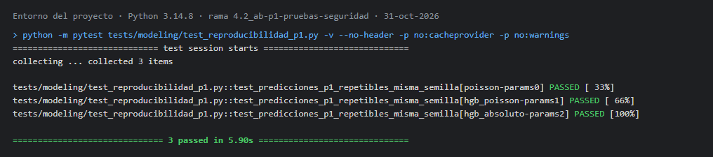

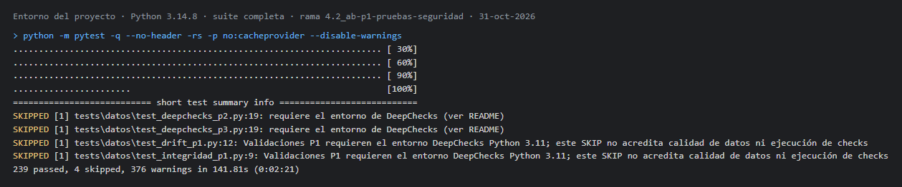

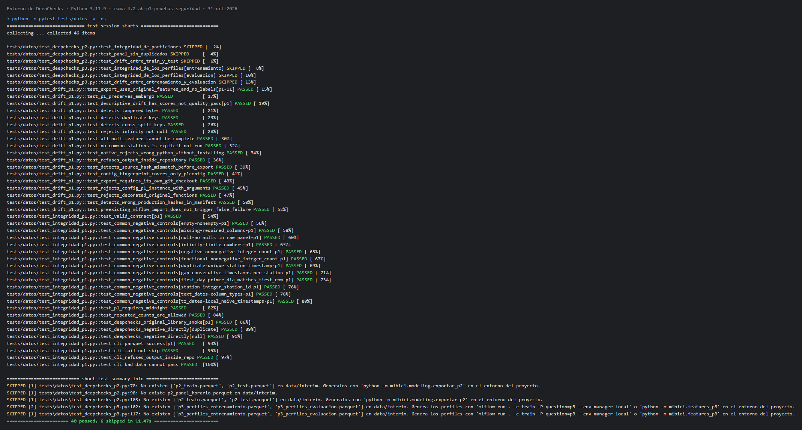

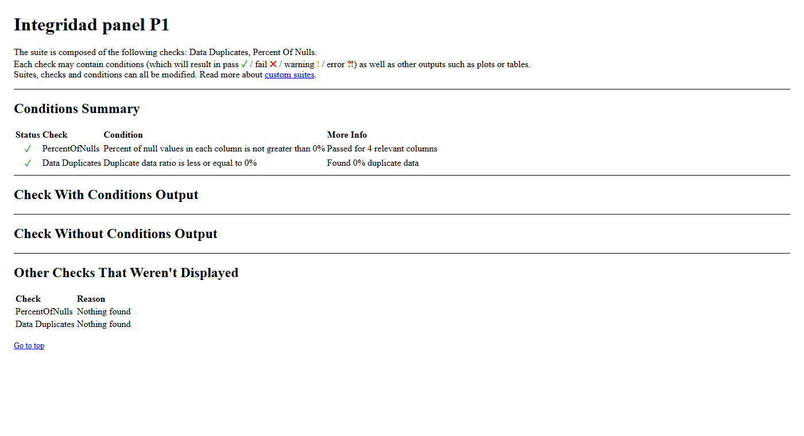

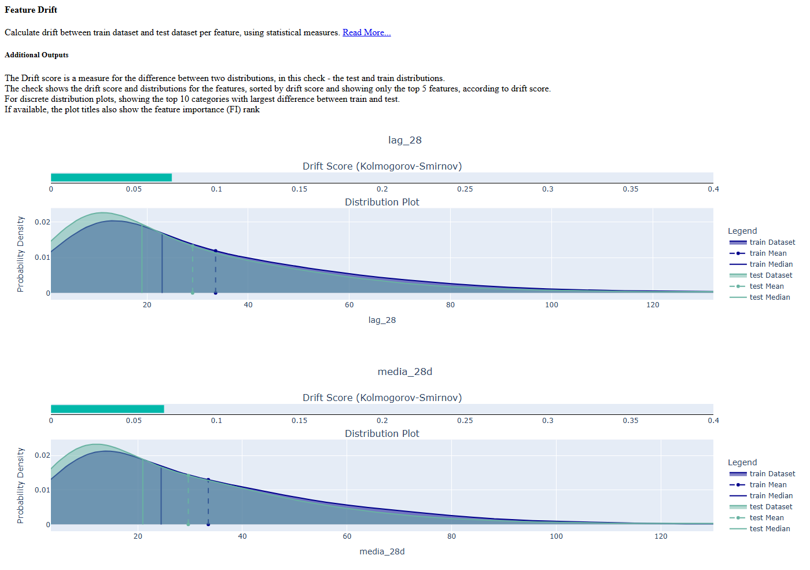

Seguridad (`docs/seguridad_p1.md`): `bandit` sobre los módulos de P1 y los scripts de validación da 12 hallazgos, 11 de severidad baja y 1 media, ninguno alta (importación de `subprocess` y llamadas fijas a `git` en `tracking.py` y el exportador, el `exec` de funciones elegidas por AST del exportador y un falso positivo por la clave `quality_pass`), cada uno con su decisión. `pip-audit` encuentra tres avisos en `mlflow` 3.16.1 que corrige la 3.17.2; P1 no usa el backend afectado ni CrewAI y el servidor escucha sólo en `127.0.0.1`, y subir la versión queda como decisión del equipo porque `requirements.txt` es común. En `requirements-deepchecks.txt`, `setuptools` 80.10.2 tiene dos avisos que corrigen la 83.0.0 y la 84.1.0, pero sigue fijado porque deepchecks 0.19.1 importa `pkg_resources`, que esas versiones ya no traen. `.gitignore` cubre `.env`, `mlflow.db`, `mlartifacts/`, `data/` y los entornos, y no hay secretos versionados.

### P2 · riesgo de estación

P2 clasifica el riesgo horario de que una estación se quede sin bicicletas o sin anclajes. La ocupación se estima a partir del flujo neto acumulado de viajes y la capacidad de la estación; no proviene de mediciones directas de inventario. El entrenamiento compara baselines con `HistGradientBoostingClassifier` balanceado y evalúa macro F1, métricas por clase y estaciones nuevas.

```powershell
mlflow run . -e train -P question=p2 -P 'hyperparameters={}' --env-manager local
```

`features_p2` genera `data/interim/p2_panel_horario.parquet` y su resumen JSON. `train_p2` busca los hiperparámetros del HGB en la rejilla de `CONFIG_P2` como corridas anidadas (un run padre `p2_busqueda_<nivel>` y un hijo por combinación), entrena tres baselines y tres candidatas (regresión logística balanceada, HGB balanceado con la mejor combinación y RandomForest balanceado, con los parámetros de `CONFIG_P2`), registra los runs con las etiquetas `model_family` y `stage_of_work`, métricas de validación y de prueba, `fit_seconds` y `model_size_mb` y guarda matrices de confusión, importancia por permutación y `p2_resultados.json` en `reports/runs_p2/` (ignorada por git, configurable con `--figuras`; `reports/figures/` conserva las figuras del reporte). Los artefactos de MLflow van a `mlartifacts/` o a la carpeta de `--artefactos` si el experimento aún no existe. Los cortes temporales, umbrales de riesgo, nivel inicial de ocupación, semilla y rejilla están en `CONFIG_P2` de `mibici/config.py`.

#### Pruebas de P2

Las pruebas de P2 usan datos fabricados dentro de cada prueba, así que no necesitan los datos reales ni el servidor de tracking. Las de `mibici/features_p2.py` están en `tests/` y las de `mibici/modeling/*_p2.py` en `tests/modeling/`.

| Archivo | Pruebas | Qué cubre |
|---|---|---|
| `tests/test_features_p2.py` | 17 | Etiquetas por umbral, estación llena o vacía, ocupación fuera de rango, capacidad cero, acumulado acotado por la capacidad, features sin la hora objetivo, limpieza de viajes duplicados o de menos de un minuto, manifiesto con fin de línea LF y horizontes de 1 a 4 horas. |
| `tests/modeling/test_train_p2.py` | 42 | Cortes y particiones temporales, métricas por clase y macro F1, figuras, búsqueda anidada en la rejilla, candidatas balanceadas, etiquetas y artefactos de cada run, registro solo del campeón con su alias, `git_commit` e hiperparámetros y opciones inválidos. |
| `tests/modeling/test_reproducibilidad_p2.py` | 4 | Con la misma semilla, dos entrenamientos de HGB, regresión logística y RandomForest dan las mismas probabilidades y métricas, y la búsqueda elige la misma configuración. |
| `tests/modeling/test_exportar_p2.py` | 1 | Exportación de train y prueba con features, objetivo y estadísticas por estación calculadas solo con train. |
| `tests/modeling/test_horizontes_p2.py` | 1 | Un run padre con un hijo por horizonte, sin registrar modelos. |
| `tests/monitoring/test_p2_datasets.py` | 10 | Nomenclatura vigente por estación, filas del mes con las columnas del contrato, estadísticas por versión, proporciones de clases, lectura del drift de Evidently, control estacional y separación de estaciones nuevas. |
| `tests/monitoring/test_p2_ab.py` | 17 | Regla de decisión del A/B con el mismo empate que la selección del campeón, métricas iguales a sklearn, Brier multiclase, bootstrap pareado reproducible, subgrupos de estaciones y cortes de B. |
| `tests/datos/test_deepchecks_p2.py` | 3 | Integridad, panel sin duplicados y drift con los datos reales; corre en el entorno de DeepChecks. |

```bash
python -m pytest -k p2
python -m pytest tests/modeling/test_reproducibilidad_p2.py -v
```

Resultado del 1 de noviembre de 2026 en el entorno del proyecto (Python 3.14.8), sobre main (`d076ebe`): 67 aprobadas (incluye una de `tests/test_tracking.py` y una de `tests/test_train_p1.py` que revisan que P2 use las mismas convenciones), 6 saltadas (los módulos de `tests/datos`, que corren en el entorno de DeepChecks) y 184 deseleccionadas en 34 s.

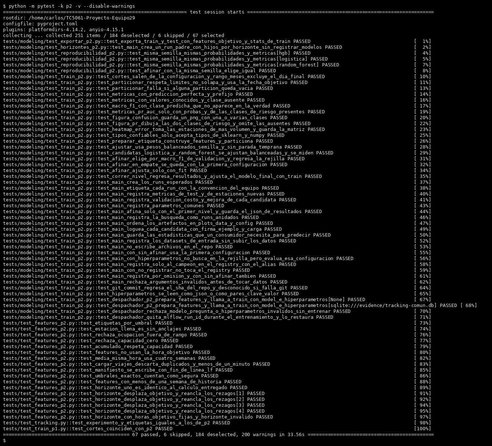

#### Campeón de P2 en el Model Registry

Al terminar, `train_p2` registra **solo al campeón** en el modelo `mibici-equipo29-p2-riesgo` (una pregunta, un modelo registrado). Antes de mover `champion`, carga la nueva versión por su URI inmutable y exige una clase válida por fila; si falla, la versión queda marcada y el alias anterior se conserva. Después mantiene la comprobación final por alias. Cada versión nueva lleva su descripción y las etiquetas de linaje `run_id`, `git_commit`, `data_version`, `experimento`, `nivel_inicial`, `criterio_seleccion` y `candidata`. La opción `--no-registrar` omite el registro; por omisión está activo. El entry point propaga modelo, hiperparámetros y URI común; con `mlflow run` el registro está activo.

El campeón se elige con una regla explícita (`mibici/registro.py`, `seleccionar_campeon`): entre las candidatas balanceadas (`CONFIG_P2.candidatas_campeon`), la de mayor recall medio de `sin_bicicletas` y `sin_anclajes` en **validación** al primer nivel inicial de la corrida; si dos candidatas difieren en menos de 0.005 de ese recall se consideran empatadas y decide el PR AUC medio de las mismas clases. No se usa la prueba para elegir y tampoco el macro F1. En la corrida real con nivel inicial 0.5 el campeón es HistGradientBoosting balanceado (recall medio de validación 0.952 contra 0.950 de la regresión logística y 0.942 del RandomForest, con mayor PR AUC).

Limitaciones de la elección:

- Es un **supuesto operativo**: quedarse sin aviso cuando una estación se vacía o se llena cuesta más que una falsa alarma, por eso se prioriza el recall de las clases de riesgo. Si el supuesto cambia, la regla y el campeón pueden cambiar.
- Por **macro F1 de prueba la baseline de persistencia es mejor** que las tres candidatas en los tres niveles iniciales (con nivel 0.5, 0.804 contra 0.741 del HGB balanceado). Las candidatas balanceadas ganan en recall de riesgo (alrededor de 0.94 y 0.96 contra cerca de 0.70 de la persistencia) pero quedan por debajo en macro F1.
- Con 0.005 de margen el HGB gana en los tres niveles iniciales; sin margen, en el nivel 0.3 la regresión logística supera al HGB por 0.002 de recall medio de validación. La diferencia entre las dos es pequeña y no se probó que sea estadísticamente distinta.

Cómo cargarlo y qué necesita quien lo use:

```python
import mlflow

import os
mlflow.set_tracking_uri(os.environ["MLFLOW_TRACKING_URI"])
modelo = mlflow.pyfunc.load_model("models:/mibici-equipo29-p2-riesgo@champion")
clases = modelo.predict(entrada)  # una clase por fila: segura, sin_bicicletas o sin_anclajes
```

- `entrada` es un `DataFrame` con las columnas de `features_p2.FEATURES`, en ese orden y como `float64` (la firma del modelo y `config/config_p2.json` del run las listan). `hora`, `dia_semana` y `fin_semana` son del instante que se pronostica, una hora después del corte: el modelo publicado es de horizonte h=1.
- Las tres últimas (`est_tasa_sin_bicis`, `est_tasa_sin_anclajes` y `est_neto_medio_hora`) son estadísticas de entrenamiento por estación y por estación y hora. Se guardan en `data/stats_estacion.csv` y `data/stats_estacion_hora.csv` del mismo run y se unen al panel con `features_p2.unir_stats`. Una estación que no estaba en entrenamiento queda con esas columnas vacías, y los modelos las aceptan como valores faltantes.
- Para obtener probabilidades, `mlflow.sklearn.load_model` sobre el mismo URI y `predict_proba`; las columnas siguen el orden de `classes_` (alfabético).
- El modelo se guarda en formato skops, que solo carga tipos de scikit-learn y NumPy declarados como confiables al registrarlo.

Cada candidata guarda en su run `plots/` (matrices de confusión, curvas precision-recall de las dos clases de riesgo e importancia por permutación del HGB), `data/` (manifiesto de datos, resumen del panel y estadísticas de entrenamiento) y `config/` (configuración del run y rejilla de la búsqueda), además del modelo con firma y ejemplo de entrada. Train, validación y prueba se registran como entradas del run (`log_input`) con una muestra de 2000 filas y la versión de los datos; no se sube ninguna tabla de datos ni se versiona `mlflow.db`, `mlruns` ni `mlartifacts`.

Con MLflow Project, después de la ingesta y de generar el manifiesto, se pueden ejecutar las features y el entrenamiento con:

```powershell
mlflow run . -e train -P question=p2 --env-manager local
mlflow run . -e train -P question=p2 -P model=hist_gradient_boosting -P hyperparameters=max_iter=300,max_leaf_nodes=63 --env-manager local
```

#### Heatmap de error y horizontes de 2 a 4 horas

Con nivel inicial 0.5, el run del HGB balanceado guarda `plots/p2_heatmap_error_ini50.png` y `data/p2_heatmap_error_ini50.csv`: la tasa de error en prueba por estación y hora objetivo. La figura muestra las 30 estaciones con más salidas y llegadas en entrenamiento, ordenadas por error medio; el CSV trae la matriz de todas las estaciones. Las copias del reporte están en `reports/figures/`.

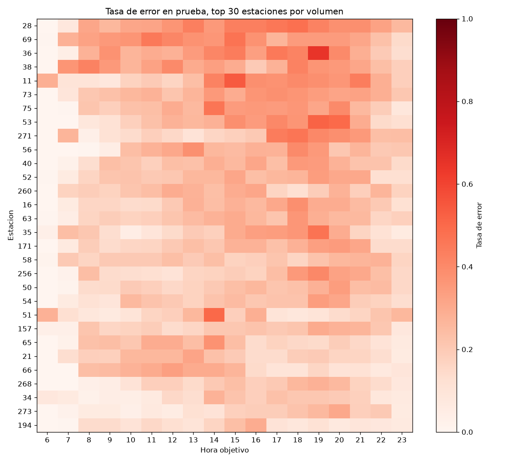

`construir_features` recibe el horizonte `h`: el objetivo es la clase al cierre de t+h y los rezagos del mismo instante del objetivo se desplazan 24-h, 168-h y 168k-h filas desde t, así que solo usan información hasta t. Solo se conservan orígenes desde las 5:00, porque antes la ocupación todavía es la del día de servicio anterior. Con h=1 las features son idénticas a las de la corrida entregada; una prueba lo comprueba.

```powershell
python -m mibici.modeling.horizontes_p2 --horizontes 1 2 3 4
```

El análisis entrena el HGB con y sin pesos de clase con los hiperparámetros de `p2_resultados.json` (sin búsqueda) y los compara con las baselines en filas pareadas: horas objetivo de 9 a 23 para todos los horizontes. Registra un run padre `p2_horizontes_ini50` con un hijo `p2_h<h>_ini50` por horizonte, no registra modelos y no toca el alias `champion`. La fila h=1 es un control pareado y por eso difiere de las cifras entregadas, que usan horas objetivo de 6 a 23. Macro F1 en prueba (`reports/figures/p2_horizontes.csv`):

| h | Mayoritaria | Semana previa | Persistencia | HGB balanceado | HGB sin pesos |
|---|---|---|---|---|---|
| 1 | 0.313 | 0.563 | 0.813 | 0.751 | 0.825 |
| 2 | 0.313 | 0.563 | 0.718 | 0.676 | 0.755 |
| 3 | 0.313 | 0.563 | 0.638 | 0.629 | 0.705 |
| 4 | 0.313 | 0.563 | 0.569 | 0.599 | 0.669 |

La persistencia cae rápido con el horizonte y la ventaja del HGB sin pesos sobre ella crece de 0.012 a 0.100. El HGB balanceado solo supera a la persistencia en macro F1 a 4 horas, pero conserva el recall de `sin_bicicletas` (de 0.938 a 0.873) mientras el de la persistencia cae de 0.724 a 0.357.

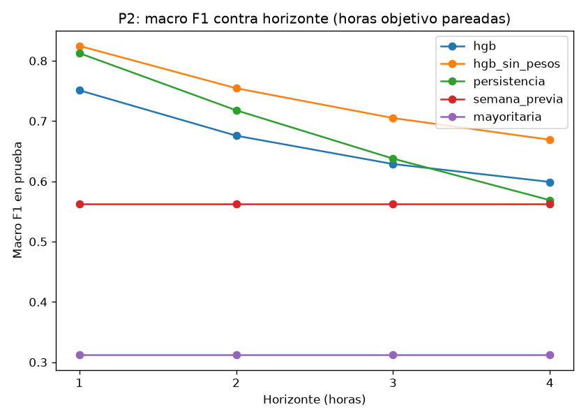

#### P2: drift y A/B testing (octubre de 2026)

P2 tiene adaptador de monitoreo y genera reportes (`mibici/monitoring/p2_datasets.py`, `p2_drift.py` y `p2_ab.py`). La unidad es la fila estación-hora con las 18 variables del modelo (horas objetivo de 6 a 23, h=1). La referencia son las filas de entrenamiento del campeón (enero de 2025 a abril de 2026) y el mes actual es octubre de 2026; el panel del mes se arma con todo el histórico para que los rezagos sean exactos, y cada estación toma la capacidad de la nomenclatura más reciente que la incluye. Además del umbral de 0.1 de Evidently, cada variable tiene un umbral calibrado (la mayor distancia de un mes del entrenamiento contra los demás); las distancias se separan por estaciones existentes y nuevas y se comparan contra octubre de 2025 como control estacional.

```powershell
python -m mibici.download_month --year 2026 --month 10
# nomenclatura_2026_10.csv en data/raw; por omisión se usan todas las de data/raw, la más reciente primero
python -m mibici.monitoring --question p2
python -m mibici.monitoring.p2_ab --registrar
python -m mibici.monitoring.p2_ab
```

Los dos módulos leen `@champion` del URI de `MLFLOW_TRACKING_URI` (o `--tracking-uri`; si no está definido, `CONFIG_P2.tracking_uri`). `p2_ab` compara el campeón (A) con el mismo HGB balanceado reentrenado con fechas objetivo de enero de 2025 a septiembre de 2026 (B) sobre las mismas filas de octubre: recall, precisión, F1 y PR-AUC por clase de riesgo, macro F1 y Brier multiclase, con intervalos del 95 % por bootstrap pareado por estación (1,000 réplicas, semilla 29). B se promueve si el recall medio de riesgo sube al menos 0.005 con intervalo sobre cero; si la diferencia queda dentro de 0.005 decide el PR-AUC medio, también con intervalo sobre cero, con el mismo margen que la selección del campeón. `--registrar` entrena B y lo registra como `challenger` con `registro.registrar_retador`, que nunca mueve `champion`; sin la opción compara `@champion` contra `@challenger`. Las salidas quedan en `reports/monitoring/2026_10/p2/` (fuera de Git): reporte HTML y JSON de Evidently, `p2_drift_calibrado.csv`, `p2_drift_distancias.png`, `p2_drift_clases.png`, `p2_ab_resultados.csv`, `p2_ab_resultados.md`, `p2_ab_resumen.json` y `manifest.json`.

Resultados de octubre de 2026 (262,404 filas de 471 estaciones, 100 nuevas): con el umbral calibrado hay drift en `salidas_lag1` (0.187 contra 0.085), `llegadas_lag1` (0.177 contra 0.080), `neto_media24` (0.128 contra 0.083) y `capacidad` (0.107 contra 0.002, por las estaciones nuevas); el calendario no cambia. En el A/B, B sube el recall medio de riesgo +0.0029 (IC [+0.0003, +0.0058]), dentro del margen, y el PR-AUC medio +0.0022 (IC [+0.0007, +0.0037]); la regla indica promover B, pero el Brier empeora +0.0026 y en las 99 estaciones nuevas para A el recall baja −0.0401. B quedó como versión 2 `challenger` y el campeón sigue en la versión 1.

### P3 · grupos de estaciones

P3 agrupa estaciones con perfiles de uso similares y los compara con su ubicación. `features_p3` lee el parquet combinado, construye los perfiles de uso por estación del periodo de entrenamiento (enero 2025 a abril 2026) y del de evaluación (mayo a septiembre 2026) y los guarda en `data/interim`. Todo lo que se elige (variables, hiperparámetros y campeón) usa solo el periodo de entrenamiento; el de evaluación solo se reporta.

Reproducir el modelo elegido desde un clon limpio, después de `ingest` y de generar el manifiesto:

```powershell
mlflow run . -e train -P question=p3 -P model=seleccion --env-manager local
```

Ese comando corre todo el flujo de `train_p3.seleccionar`:

1. **Baseline** `kmeans_geo`: KMeans sobre la ubicación (k = 5).
2. **Búsquedas con runs anidados** (un run padre `p3-busqueda-<modelo>` y un hijo por combinación): `kmeans_uso` con k de 3 a 8 y `gmm_uso` con 3 a 8 componentes y cuatro tipos de covarianza.
3. **Candidatas**: C1 KMeans de uso con k = 5 (referencia de la entrega 1), C2 el mejor KMeans de la búsqueda y C3 la mejor GaussianMixture, reentrenadas con todo el periodo de entrenamiento.
4. **Selección y registro** del campeón y del retador en el Model Registry.

Los modelos de uso (`mibici/modeling/modelos_p3.py`) son pipelines de scikit-learn que reciben las 12 variables de uso, eligen por VIF las que no son redundantes, las estandarizan y agrupan; el grupo 0 es el de menor uso.

**Validación por estaciones** (`busqueda_p3.py`): 5 particiones reproducibles de las estaciones de entrenamiento; en cada una se entrena con el 80 % y se valida con el 20 % reservado, con la selección por VIF y el escalado aprendidos solo con el 80 %. Las métricas `val_` son el promedio de las particiones (silueta, Davies-Bouldin y Calinski-Harabasz en el espacio de uso) y `val_ari_estabilidad` es el ARI promedio entre las asignaciones de los cinco modelos. Limitación: la validación separa estaciones, no periodos, así que mide si los grupos se sostienen en estaciones no vistas del mismo periodo.

**Selección del campeón** (`seleccion_p3.py`): ranking por mayor silueta de validación; a menos de 0.01 de la mejor decide la estabilidad (ARI), luego Davies-Bouldin y luego la menor complejidad. El campeón es la primera del ranking que cumple los criterios de interpretabilidad fijados antes de correr: cada grupo con al menos 5 % de las estaciones (I1), grupos distinguibles por al menos 0.5 desviaciones estándar (I2), nombrables sin repetir nombre (I3) y al menos un grupo que se vacía y otro que se llena en la mañana (U1). La tabla queda en `data/criterios_interpretabilidad.csv` de cada candidata.

**Artefactos de las candidatas**: `model/` (pipeline con firma y ejemplo de entrada), `data/` (manifiesto, asignación de estaciones, perfil de uso por grupo, bitácora de limpieza y criterios), `plots/` (mapa y perfiles de los grupos) y `config/config_corrida.json`; los perfiles se registran con `log_input`. Solo hay datos por estación, ninguno de las personas usuarias.

#### Campeón de P3 en el Model Registry

El modelo registrado es `mibici-equipo29-p3-grupos`. Usamos **aliases** en lugar de etapas, porque las etapas están en desuso en MLflow y un alias se mueve sin crear estados intermedios: `champion` apunta a la versión en producción y `challenger` a la siguiente candidata que cumple los criterios, lista para reemplazarla. Cada versión lleva su descripción y su linaje en etiquetas: run de origen, `git_commit`, `data_version`, experimento, candidata, posición en el ranking y motivo. Cada corrida de `model=seleccion` registra versiones nuevas, carga cada una por `models:/mibici-equipo29-p3-grupos/<versión>` y comprueba su predicción, y solo entonces mueve ambos aliases; si la comprobación falla, los aliases se quedan en las versiones anteriores y las nuevas quedan marcadas con `comprobacion = fallida`.

```python
import mlflow

import os
mlflow.set_tracking_uri(os.environ["MLFLOW_TRACKING_URI"])
modelo = mlflow.pyfunc.load_model("models:/mibici-equipo29-p3-grupos@champion")
grupos = modelo.predict(perfiles)  # un grupo por estación
```

`perfiles` es un `DataFrame` con las 12 variables de `CONFIG_P3.prioridad_variables` como `float64` (la firma las lista). El modelo usa clases de `mibici.modeling.modelos_p3`, así que requiere el paquete `mibici` instalado (`requirements.txt` lo instala con `-e .`).

Otros comandos (por separado, con `python -m mibici.modeling.train_p3` o con `mlflow run`):

```powershell
mlflow run . -e train -P question=p3 --env-manager local                                      # baseline k = 4, 5 y 6
mlflow run . -e train -P question=p3 -P model=kmeans_uso -P hyperparameters=k=4 --env-manager local
mlflow run . -e train -P question=p3 -P model=gmm_uso -P hyperparameters=n_components=4,covariance_type=diag --env-manager local
mlflow run . -e train -P question=p3 -P model=kmeans_uso -P hyperparameters=buscar=1 --env-manager local
```

Las fechas, franjas horarias, umbrales de limpieza y de VIF, semilla, rejillas de búsqueda, particiones, criterios y nombre del modelo registrado están en `CONFIG_P3` de `mibici/config.py`.

#### Pruebas de P3

Las pruebas de P3 usan datos fabricados dentro de cada prueba, así que no necesitan los datos reales ni el servidor de tracking, y siguen la estructura del paquete: las de `mibici/features_p3.py` en `tests/` y las de `mibici/modeling/*_p3.py` en `tests/modeling/`.

| Archivo | Pruebas | Qué cubre |
|---|---|---|
| `tests/test_features_p3.py` | 24 | Lectura sin datos personales, limpieza mínima y bitácora, flujos horarios, periodos sin traslape, perfiles, elegibilidad, selección de variables por VIF y guardado y carga de los perfiles. Casos límite: frontera de un minuto (59 s se quita; 60 y 61 s se conservan), viaje que termina antes de empezar, id de estación no numérico, viaje de ida y vuelta, mínimo exacto de días y estación con una variable faltante. |
| `tests/modeling/test_modelos_p3.py` | 24 | Pipelines de `kmeans_uso` y `gmm_uso` con las 12 variables, selección por VIF aprendida solo con lo que recibe `fit`, grupos ordenados que no dependen de la semilla e hiperparámetros y opciones de la CLI inválidos. |
| `tests/modeling/test_busqueda_p3.py` | 12 | Particiones por estaciones reproducibles que cubren todas las estaciones, métricas de validación y estabilidad, desempates del ranking y configuraciones con particiones inválidas. |
| `tests/modeling/test_seleccion_p3.py` | 22 | Criterios de interpretabilidad, elección del campeón y su motivo, registro con aliases y carga por nombre; si la comprobación de la versión falla (carga, predicción o grupos no finitos, negativos o fraccionarios), los aliases se quedan en las versiones anteriores. |
| `tests/modeling/test_artefactos_p3.py` | 4 | Artefactos del run (modelo, datos, gráficas y configuración), asignación sin datos personales y tipos confiables de `skops`. |
| `tests/modeling/test_reproducibilidad_p3.py` | 4 | Con la semilla de P3 (42), dos entrenamientos de `kmeans_uso` y de `gmm_uso` dan los mismos grupos y las mismas métricas, y la validación por estaciones da las mismas métricas (sin `val_fit_seconds`, que es tiempo de reloj). |

```bash
python -m pytest -k p3
python -m pytest tests/modeling/test_reproducibilidad_p3.py -v
```

Resultado del 1 de noviembre de 2026 en Windows, con el entorno del proyecto (Python 3.14.7), sobre main (`8e8d710`): 90 aprobadas, 5 saltadas (los módulos de `tests/datos`, que corren en el entorno de DeepChecks) y 161 deseleccionadas en 18 s.

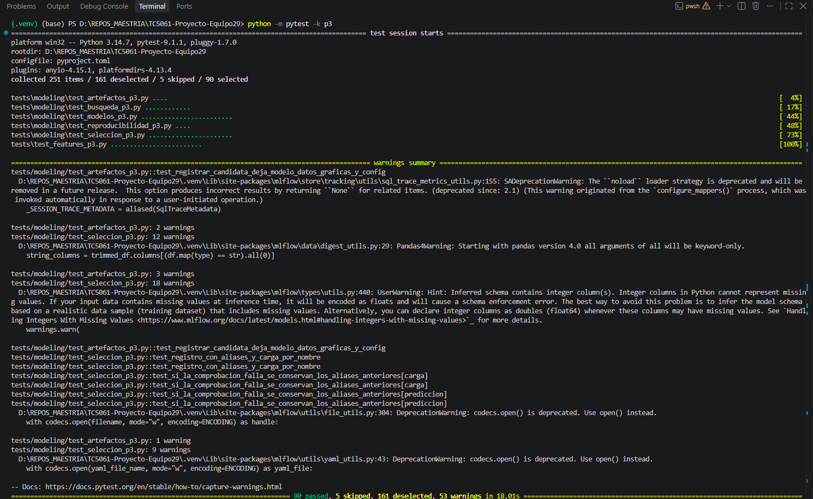

### Pruebas, lint y formato

```bash
python -m pytest
ruff check .
ruff format --check .
```

La configuración de Ruff en `pyproject.toml` revisa `mibici/`.

### Validación de datos con DeepChecks

Las pruebas de `tests/datos/` revisan con DeepChecks las tablas reales que genera cada pregunta: la integridad de cada tabla y el drift entre los periodos de entrenamiento y evaluación. deepchecks 0.19.1, la versión más reciente, no funciona con las versiones de este proyecto (Python 3.14, NumPy 2, pandas 3 y scikit-learn 1.9), así que corre en un entorno aparte que requiere **Python 3.11**. En el entorno del proyecto, `python -m pytest` las marca como saltadas.

Primero se generan las tablas en el entorno del proyecto (`mlflow run . -e ingest --env-manager local` y `mlflow run . -e train --env-manager local`). Después, desde la raíz del repositorio:

```bash
<python 3.11> -m venv .venv-deepchecks      # Windows: py -3.11 o ruta de python.exe; Linux/macOS: python3.11
.venv-deepchecks\Scripts\activate           # Windows; en Linux o macOS: source .venv-deepchecks/bin/activate
pip install -r requirements-deepchecks.txt
python -m pytest tests/datos -v
```

Si faltan las tablas, las pruebas se saltan con un mensaje que indica cómo generarlas. Los reportes HTML y los resúmenes JSON quedan en `reports/deepchecks/` y no se versionan.

| Área | Datos | Qué se valida |
|---|---|---|
| Features | Datos sintéticos en `tests/test_features_pipeline.py` | Casos normales y límite del pipeline compartido, ajuste train-only y predicciones reproducibles con la misma semilla. No hay un dataset de features compartido con semántica train/test para un drift común. |
| EDA | `data/interim/features_eda.parquet`, generado desde `data/processed/combined_dataset.parquet` por `python -m mibici.features_eda`; exporta solo las columnas usadas por EDA y conserva los grupos Parquet | Muestra reproducible y estratificada por grupo Parquet. DeepChecks `MixedDataTypes` y `PercentOfNulls` sobre entradas; ejecuta el transformador EDA real y exige salida numérica finita y sin nulos. Los nulos de entrada se reportan porque los imputadores forman parte de la transformación. |
| P1 | `data/interim/p1_panel_diario.parquet` y las 11 variables de entrenamiento y prueba que salen de él | `test_integridad_p1.py` y `test_drift_p1.py` usan paneles fabricados, así que no dependen de que existan las tablas: revisan el contrato del panel (tipos, conteos enteros no negativos, fechas diarias consecutivas, claves estación-fecha únicas), los checks `PercentOfNulls` y `DataDuplicates`, la exportación de las variables y el cálculo del drift, con controles negativos. El panel real se valida con `scripts/p1/validar_panel_p1.py`, `exportar_features_p1.py` y `medir_drift_p1.py`, que escriben fuera del repositorio; los comandos y resultados están en `docs/validacion_datos_p1.md`. El drift se mide para todas las estaciones y para las presentes en ambos periodos, sin umbral de aprobación. |
| P2 | `data/interim/p2_train.parquet` y `p2_test.parquet`, que genera `python -m mibici.modeling.exportar_p2` (18 features y objetivo, nivel inicial 0.5, estadísticas por estación solo de train) | Sobre una muestra de hasta 100 000 filas de cada tabla (semilla 29). Integridad: features numéricas, objetivo con sus tres clases, faltantes solo en las columnas donde se esperan (lags sin historia y estadísticas de estaciones nuevas en prueba), una sola fila por estación y hora en el panel, y reporte de MixedDataTypes, PercentOfNulls y DataDuplicates. Drift entre train y prueba: Feature Drift, Label Drift y Multivariate Drift; falla si el drift de alguna variable o de la etiqueta pasa de 0.2, o si el AUC del clasificador de dominio pasa de 0.75. |
| P3 | `data/interim/p3_perfiles_entrenamiento.parquet` y `p3_perfiles_evaluacion.parquet` | Integridad de cada periodo sobre las 12 variables candidatas (faltantes, duplicados, tipos mezclados, columnas constantes y variables muy correlacionadas) y drift entre entrenamiento (enero 2025–abril 2026) y evaluación (mayo–septiembre 2026). La integridad falla si alguna condición no se cumple; el drift se mide y se reporta sin fallar, porque describe cómo cambió el uso de las estaciones y no un error en los datos. |

#### Validación de EDA

Las pruebas unitarias de `tests/test_features_eda.py` cubren la imputación de faltantes, el escalado de variables numéricas y la codificación de género, incluida una categoría no observada durante el ajuste. También verifican que la exportación a `data/interim/features_eda.parquet` conserve los grupos Parquet, incluya solo las columnas requeridas por EDA y rechace un esquema incompleto.

La validación con DeepChecks consume ese artefacto intermedio y toma una muestra reproducible de hasta 2 000 filas por grupo Parquet. Comprueba los tipos mixtos y cuantifica los valores faltantes en las entradas; estos se esperan en algunas columnas y se tratan mediante los imputadores de la transformación. Después de aplicar el transformador EDA, las features resultantes son numéricas, finitas y no contienen nulos.

No se evalúan duplicados sobre estas variables: viajes distintos pueden compartir legítimamente los mismos valores de features. Tampoco se mide drift, porque EDA no define una partición train/test común con semántica adecuada para esta comparación. DeepChecks genera reportes HTML de integridad y transformación, además de un resumen JSON de nulos, bajo `reports/deepchecks/`; son artefactos locales ignorados por Git.

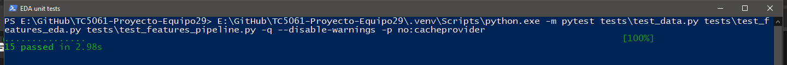

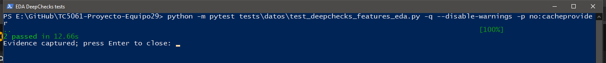

#### Chequeos de seguridad de EDA y módulos compartidos

La revisión de `dataset.py`, `features_eda.py`, `mlflow_project.py`, `plots.py`,
`modeling/train.py` y `modeling/predict.py` está detallada en
[`docs/seguridad_eda.md`](docs/seguridad_eda.md). Bandit revisó 621 líneas y reportó dos
hallazgos B310 de severidad media en `dataset.py`; el uso predeterminado parte de la página
HTTPS de MiBici, pero el esquema, host y redirecciones de las URL no quedan restringidos.
Por ello se documentan como riesgo condicionado, no como falsos positivos ni como corregidos.

`pip-audit` revisó los pines compartidos de ambos archivos de requisitos: reportó tres CVE
para `mlflow==3.16.1` y dos avisos distintos para `setuptools==80.10.2` (uno aparece dos
veces en la salida). Las dependencias no se actualizaron en esta revisión de EDA.

```powershell
bandit mibici\dataset.py mibici\features_eda.py mibici\mlflow_project.py mibici\plots.py mibici\modeling\train.py mibici\modeling\predict.py
pip-audit -r requirements-deepchecks.txt --no-deps --disable-pip --format markdown
```

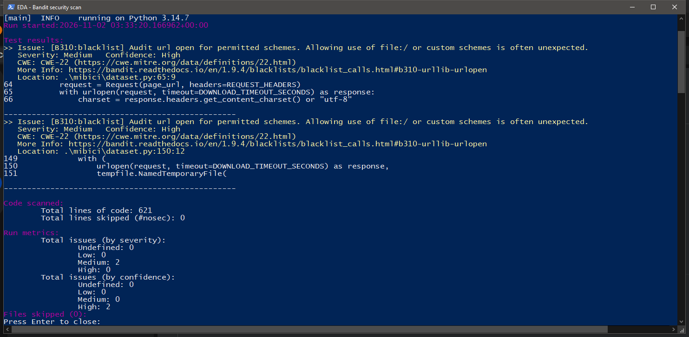

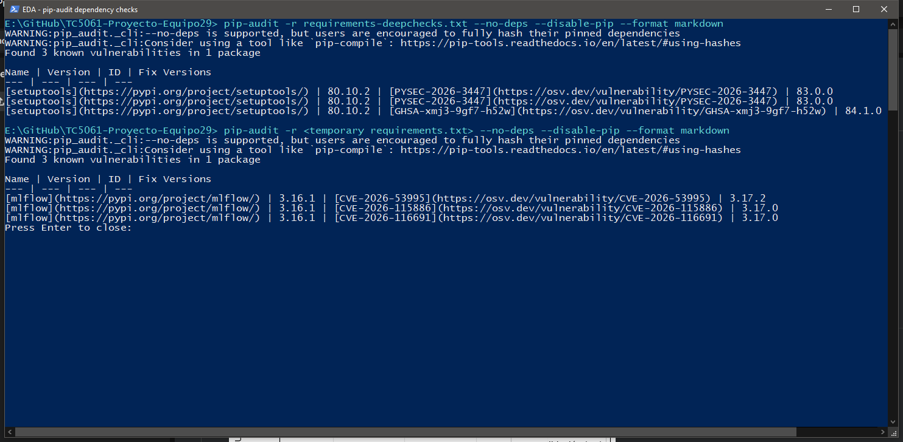

#### Hallazgos de P2 con los datos reales:

- Drift por variable bajo: el máximo es `neto_media24` con 0.071, seguido de las ocupaciones (0.054 a 0.055); `hora` tiene 0.
- Drift de la etiqueta: Cramér's V de 0.074.
- Multivariado: AUC de 0.600 (drift de 0.200). Toda la importancia del clasificador de dominio está en `est_tasa_sin_bicis`: el 13.8 % de las filas de prueba son de estaciones nuevas sin estadísticas de train y esa columna queda vacía, mientras que en train nunca falta. Es esperado por la partición temporal y coincide con el bloque de estaciones nuevas que se evalúa aparte (`test_nuevas_*`).

Resultado del 1 de noviembre de 2026 con `python -m pytest tests/datos/test_deepchecks_p2.py -v` en el entorno de DeepChecks (Python 3.11.17): 3 aprobadas en 21 s.

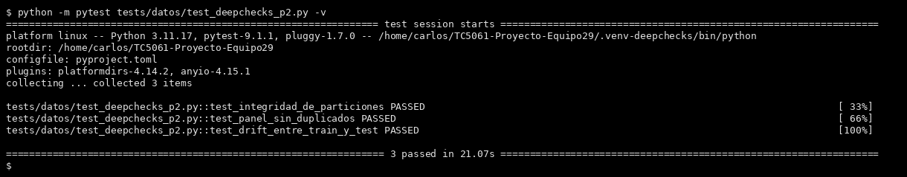

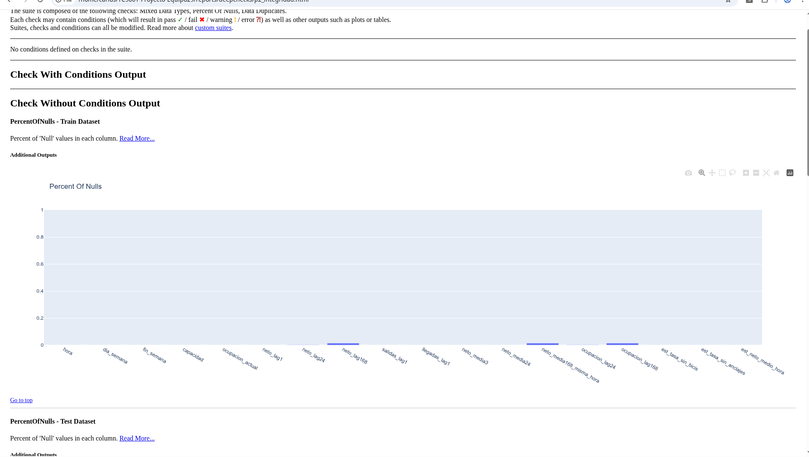

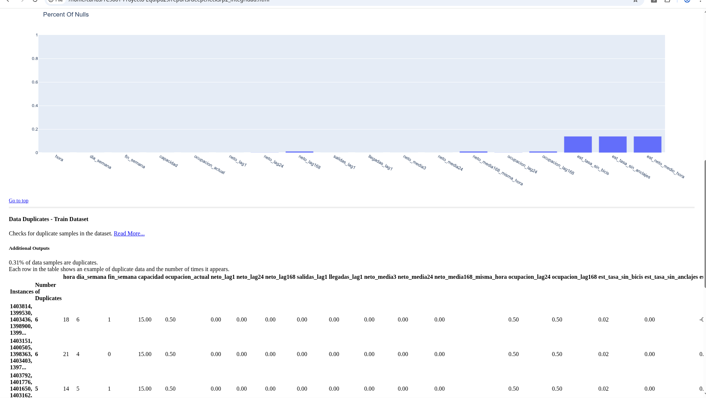

#### Hallazgos de P3 con los datos reales

Resultado del 1 de noviembre de 2026 con `python -m pytest tests/datos/test_deepchecks_p3.py -v` en el entorno de DeepChecks (Python 3.11.9): 3 aprobadas en 26 s.

- Integridad: las condiciones pasan en los dos periodos (370 estaciones de entrenamiento y 453 de evaluación): sin faltantes, duplicados, tipos mezclados ni columnas constantes, y ningún par de variables con correlación mayor que 0.9.
- Drift por variable (Kolmogorov-Smirnov): el máximo es `weekend_share` con 0.161, seguido de `log_trips_day` (0.113) y `dep_night` (0.104); las demás quedan por debajo de 0.09.
- Multivariado: drift de 0.237 (AUC del clasificador de dominio de 0.619), cerca del límite de 0.25 de DeepChecks. `weekend_share` explica el 72 % de la diferencia: en mayo a septiembre de 2026 las estaciones tienen una proporción mayor de viajes en fin de semana. Es un cambio en el uso, no un error en los datos; por eso se reporta sin fallar, y es una razón para revisar los grupos de P3 cuando se reentrene con datos más recientes.

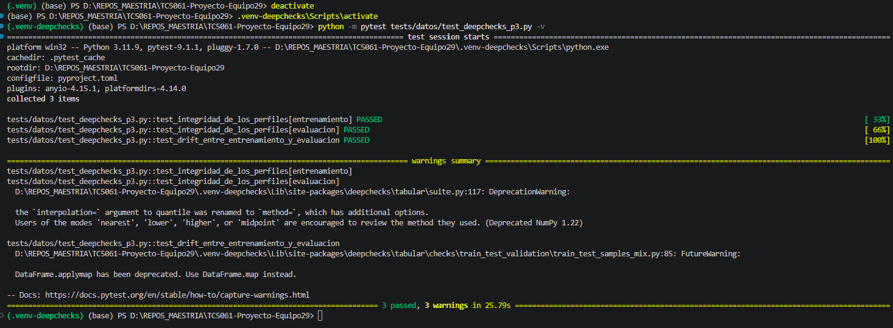

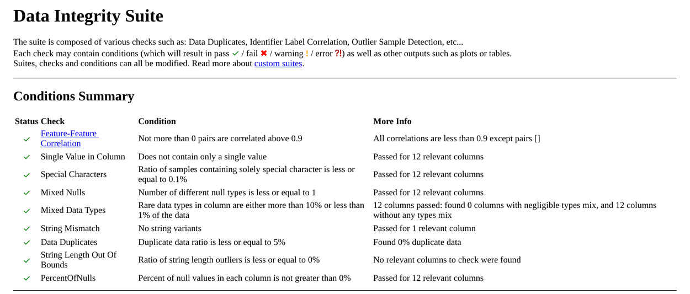

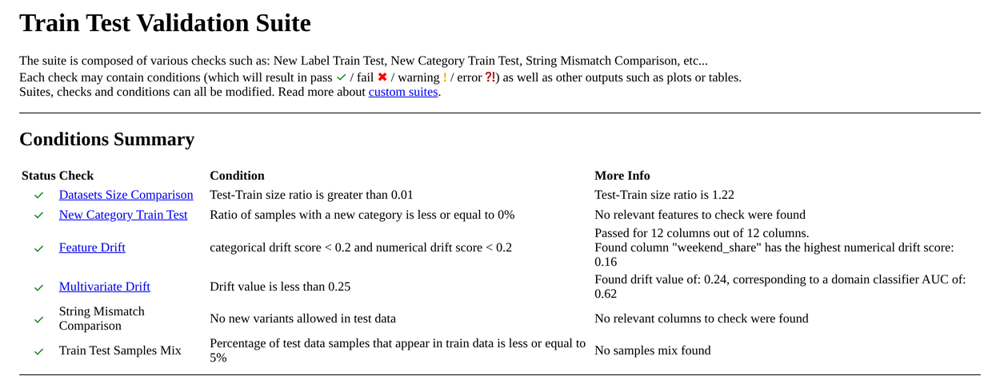

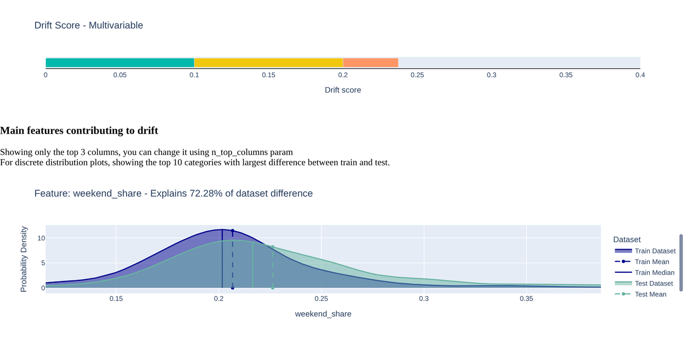

### Chequeos de seguridad de P1

La revisión de seguridad del código, las dependencias y los secretos de P1 está en `docs/seguridad_p1.md`. Para repetirla, con `bandit` y `pip-audit` instalados en un entorno fuera del repositorio (`pip install bandit==1.9.4 pip-audit==2.10.1`):

```bash
bandit mibici/config.py mibici/features.py mibici/features_pipeline.py mibici/registro_p1.py mibici/tracking.py mibici/modeling/train_p1.py scripts/p1/validar_panel_p1.py scripts/p1/exportar_features_p1.py scripts/p1/medir_drift_p1.py
pip-audit -r <copia-de-requirements.txt-sin-pip-ni-editable> --no-deps --disable-pip
pip-audit -r requirements-deepchecks.txt --no-deps --disable-pip
pip-audit --path <entorno-del-proyecto>/Lib/site-packages
pip-audit --path <entorno-de-deepchecks>/Lib/site-packages
```

Alcance: `bandit` revisa los módulos que usa el entrenamiento de P1 y los scripts de validación de datos; `pip-audit` revisa los pines de los dos archivos de requisitos y los paquetes instalados en el entorno del proyecto (Python 3.14.8) y en el de DeepChecks (Python 3.11.9). En las capturas, `pip-audit` lleva además `--aliases on --progress-spinner off` y una caché vacía en cada corrida (`--cache-dir`).

Resultado del 1 de noviembre de 2026 en Windows, sobre main `d076ebe` (los archivos revisados son los mismos en `d206d2a`):

- `bandit` revisa 2,198 líneas y encuentra 12 hallazgos: 11 de severidad baja y 1 media (el `exec` del exportador), ninguno alta. Son los 12 que explica el documento; las 3 líneas de más frente a las 2,195 que registra son campos de `P2Config` en `mibici/config.py`.
- `requirements.txt` (19 pines): 3 avisos en `mlflow` 3.16.1, CVE-2026-53995 (corrige la 3.17.2), CVE-2026-115886 y CVE-2026-116691 (corrige la 3.17.0).
- `requirements-deepchecks.txt`: los avisos de `setuptools` 80.10.2; cuenta 3 porque lista dos veces PYSEC-2026-3447, así que son 2 avisos distintos (corrigen la 83.0.0 y la 84.1.0).
- Entorno del proyecto: 12 avisos en 4 paquetes, 11 distintos porque el de `certifi` aparece dos veces: `mlflow` 3.16.1 (los mismos 3), `certifi` 2026.7.22 (1, corrige la 2026.10.18), `pyasn1` 0.6.4 (4, corrige la 0.6.5) y `tornado` 6.5.10 (3, corrige la 6.6). `mibici` se omite porque no está en PyPI.
- Entorno de DeepChecks: 15 avisos en 2 paquetes, 8 distintos: `pip` 24.0 (6) y `setuptools` 80.10.2 (los mismos 2).

La decisión sobre cada hallazgo está en el documento.

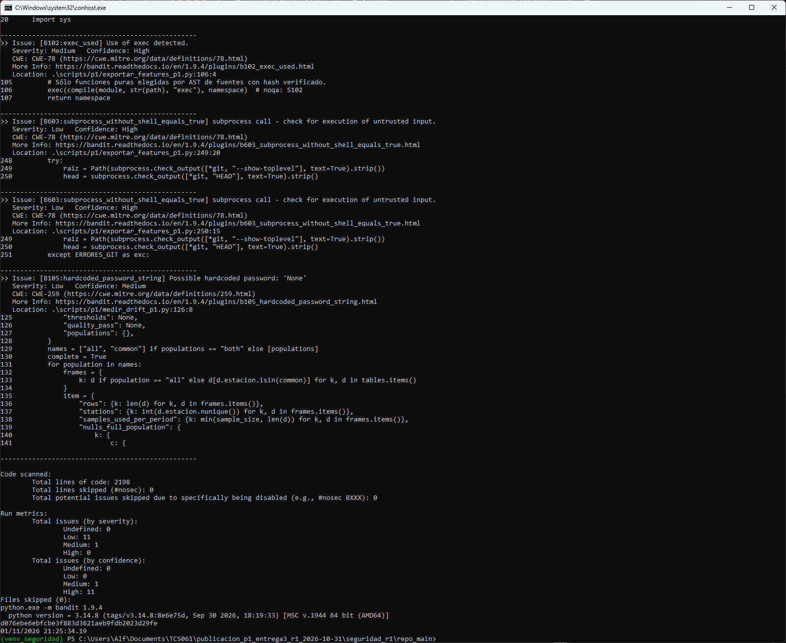

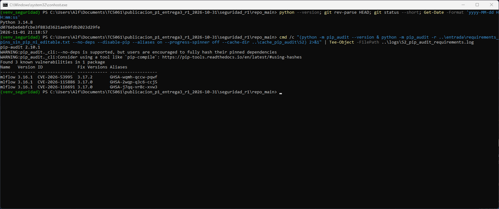

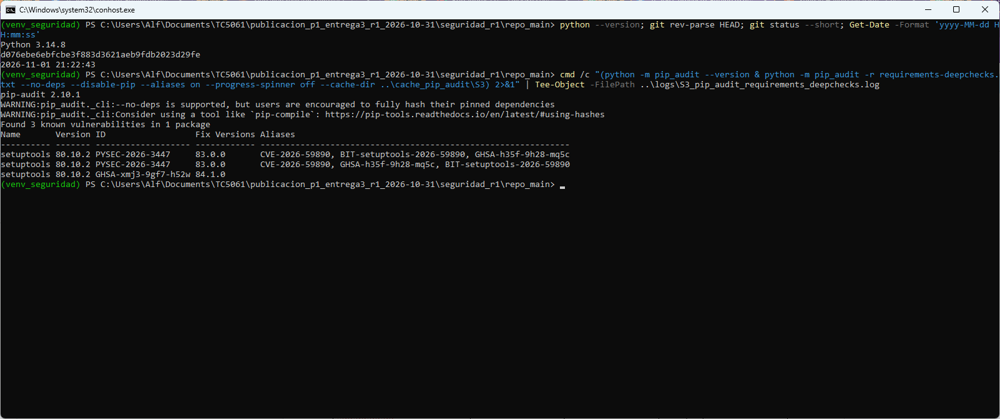

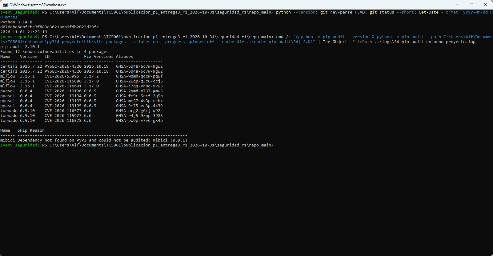

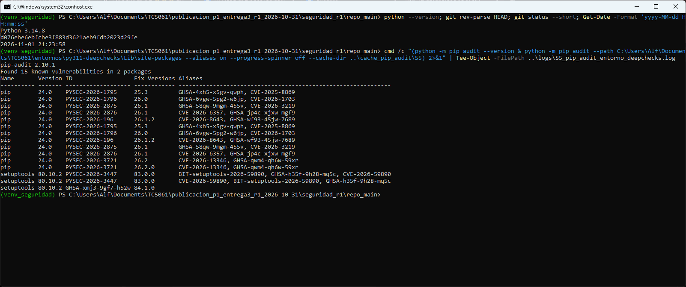

### Chequeos de seguridad de P2

La revisión de seguridad del código, las dependencias y los secretos de P2 está en `docs/seguridad_p2.md`. Para repetirla, con `bandit` y `pip-audit` instalados en un entorno fuera del repositorio (`pip install bandit==1.9.4 pip-audit==2.10.1`):

```bash
bandit mibici/features_p2.py mibici/manifiesto_p2.py mibici/registro.py mibici/modeling/train_p2.py mibici/modeling/horizontes_p2.py mibici/modeling/exportar_p2.py
pip-audit -r requirements-deepchecks.txt --no-deps --disable-pip
```

`requirements.txt` se audita desde una copia sin las líneas `pip` y `-e .`, como se explica en el documento.

Resultado del 1 de noviembre de 2026: `bandit` revisa 1,552 líneas y encuentra 6 hallazgos de severidad baja, todos en `train_p2.py` (`import pickle`, `import subprocess` y las dos llamadas con argumentos fijos a `git`), ninguno medio ni alto. `pip-audit` sobre `requirements-deepchecks.txt` reporta los avisos de `setuptools` 80.10.2; cuenta 3 porque lista dos veces PYSEC-2026-3447, así que son 2 avisos distintos. La decisión sobre cada hallazgo está en el documento.

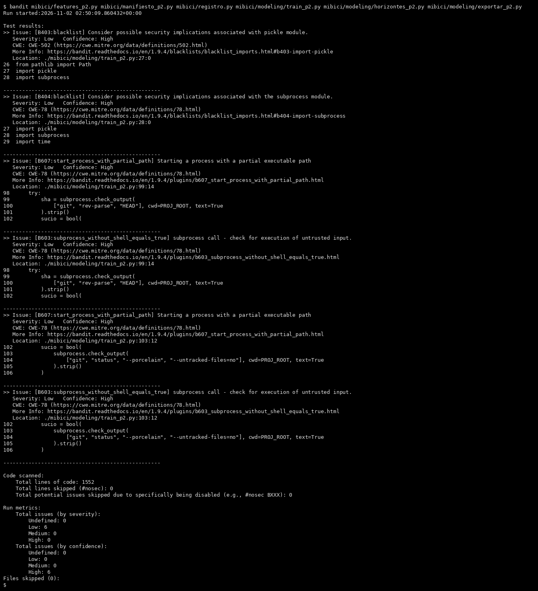

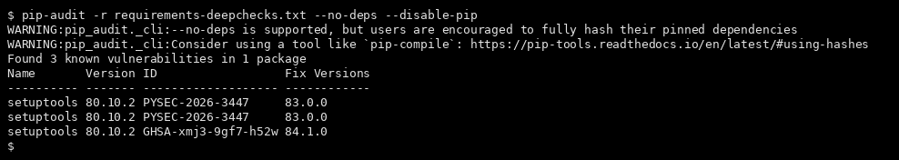

### Chequeos de seguridad de P3

La revisión de seguridad del código, las dependencias, los secretos y los datos de P3 está en `docs/seguridad_p3.md`. Para repetirla, con `bandit` y `pip-audit` instalados en un entorno fuera del repositorio (`pip install bandit==1.9.4 pip-audit==2.10.1`):

```bash
bandit mibici/features_p3.py mibici/modeling/modelos_p3.py mibici/modeling/busqueda_p3.py mibici/modeling/seleccion_p3.py mibici/modeling/artefactos_p3.py mibici/modeling/train_p3.py
pip-audit -r requirements-deepchecks.txt --no-deps --disable-pip
```

`requirements.txt` se audita desde una copia sin las líneas `pip` y `-e .`, como se explica en `docs/seguridad_p1.md`.

Resultado del 1 de noviembre de 2026 en Windows: `bandit` revisa 1,596 líneas y encuentra 3 hallazgos de severidad baja en `train_p3.py` (`import subprocess` y la llamada con argumentos fijos a `git`), ninguno medio ni alto. `pip-audit` sobre `requirements-deepchecks.txt` reporta los avisos de `setuptools` 80.10.2; cuenta 3 porque lista dos veces PYSEC-2026-3447, así que son 2 avisos distintos. La decisión sobre cada hallazgo está en el documento.

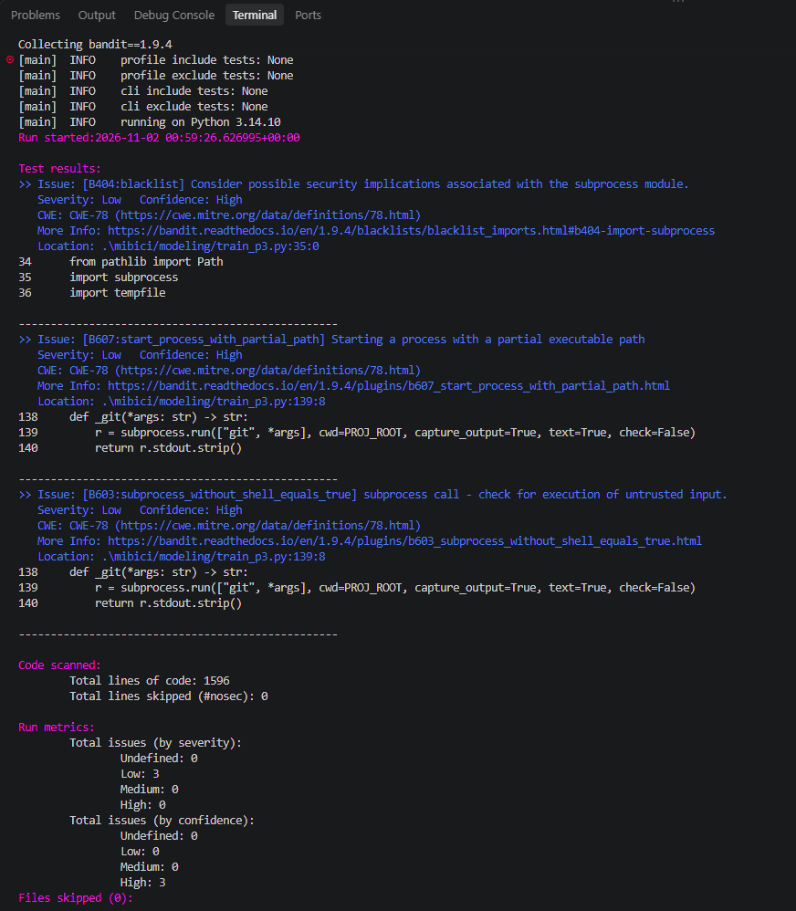

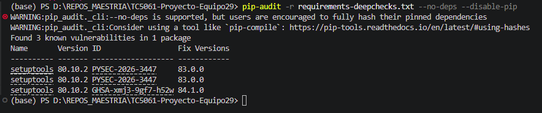

## Monitoreo de datos y modelos

Se agregó una base compartida para monitoreo y un ejemplo P1 que compara las features de
entrenamiento con las del mes disponible de octubre de 2026 usando Evidently. Genera un reporte de
drift/calidad y un manifiesto de periodos, tamaños y hashes; no entrena, compara ni promueve
modelos. La guía incluye el procedimiento de descarga, los periodos de datos de P1/P2/P3 y la
estructura para ampliar el monitoreo por pregunta: [docs/monitoring/guia.md](docs/monitoring/guia.md).
Los reportes generados se guardan localmente en `reports/monitoring/` y están excluidos de Git.

## Seguimiento en MLflow

Esta sección conserva el flujo local anterior al despliegue con Docker; la configuración más reciente de Docker y FastAPI se describe inmediatamente después.

Todos los runs usan el experimento `mibici-equipo29`, con nombre descriptivo y etiquetas `question` (P1, P2 o P3), `team`, `author`, `data_range`, `seed`, `data_version`, `git_commit` y `git_dirty`. Las métricas indican el conjunto en que se calculan (`val_mae`, `test_mae`, ...). El almacén es local: `mlflow.db` y `mlartifacts/` en la raíz del repositorio, ambos fuera de git.

### Servidor de tracking

El Model Registry necesita un almacén con base de datos. Desde la raíz del repositorio, para que la base sea el mismo `mlflow.db` que usa el proyecto por omisión:

```powershell
mlflow server --backend-store-uri sqlite:///mlflow.db --port 5000 --workers 1
```

En Windows, el servidor con varios workers deja de aceptar conexiones en algunos de ellos (`WinError 10022`); `--workers 1` lo evita. En Linux y macOS se puede omitir. En otra terminal, también desde la raíz, apunta ambas variables al servidor y lanza el proyecto:

```powershell
$env:MIBICI_TRACKING_URI = "http://127.0.0.1:5000"
$env:MLFLOW_TRACKING_URI = $env:MIBICI_TRACKING_URI
mlflow run . -e ingest --env-manager local --experiment-name mibici-equipo29
mlflow run . -e train -P question=all -P 'hyperparameters={}' --env-manager local --experiment-name mibici-equipo29
```

La interfaz queda en http://127.0.0.1:5000 y los artefactos que sube el servidor en `mlartifacts/`. Las dos corridas de proyecto que crea `mlflow run` (`ingest` y `train`) llevan un nombre automático y no tienen la etiqueta `question`; las corridas de entrenamiento sí. No mezcles en una misma sesión el servidor y una URI `sqlite:///` directa: cada una debe apuntar al mismo `mlflow.db` de la raíz. Sin servidor, la interfaz se abre con:

```bash
mlflow ui --backend-store-uri sqlite:///mlflow.db
```

Usar el mismo nombre de experimento en otro archivo SQLite no junta las corridas: para compararlas deben registrarse en el mismo almacén.

## Despliegue inicial con MLflow y FastAPI

Esta configuración inicial prepara una sola imagen Docker, reutilizada por dos servicios: MLflow y la API FastAPI. MLflow guarda su base de datos y artefactos en volúmenes persistentes; la API obtiene el modelo del Registry usando variables de entorno. La estructura de la API integra P1, P2 y P3, y cada modelo se carga por separado.

### Qué se configuró

- El servicio `mlflow` usa `mlflow-artifacts:/` y sirve los artefactos mediante el servidor, para que los clientes no dependan de rutas `file:///` de una computadora.
- El servicio `api` se conecta a MLflow por la red de Compose (`http://mlflow:5000`) y obtiene cada modelo según su variable `P1_MODEL_URI`, `P2_MODEL_URI` o `P3_MODEL_URI`.
- El puerto de MLflow se publica únicamente en `127.0.0.1:5000` durante el desarrollo local.
- `tracking.configurar_experimento` ofrece el patrón para crear experimentos remotos sin imponer una ruta local de artefactos. P3 ya lo usa en `train_p3` y P2 en `train_p2`, `horizontes_p2` y `p2_ab`. **El entrenador de P1 aún no se ha migrado a ese helper.** Cada responsable deberá integrar y validar el patrón en su flujo antes de registrar un modelo para esta API.

### Cómo ejecutar

Para servir el campeón de P1, siembra primero el Registry (ver [P1 en el contenedor](#p1-en-el-contenedor-campeón-del-registry)): MLflow crea una base vacía al iniciar y la siembra no la sobrescribe. Si ya iniciaste MLflow en este proyecto de Compose, siembra en otro (`COMPOSE_PROJECT_NAME`).

Desde la raíz del repositorio, inicia MLflow:

```powershell
docker compose up -d mlflow
docker compose ps
```

La interfaz de MLflow queda disponible en `http://localhost:5000`. Los procesos de entrenamiento ejecutados en el host deben usar `http://localhost:5000`; la API dentro de Compose utiliza `http://mlflow:5000`.

**Prerequisito pendiente:** antes de entrenar para este despliegue, el responsable de P1 debe migrar su entrenador a `tracking.configurar_experimento` y comprobar que el experimento nuevo tenga artefactos `mlflow-artifacts:/`. Hasta entonces, el comando de entrenamiento local existente puede guardar artefactos `file:///...`, que el contenedor no podrá cargar. El campeón actual de P1 no necesita reentrenarse: se registró contra el servidor de tracking y ya usa `mlflow-artifacts:/` (ver «P1 en el contenedor»).

Cuando exista una versión válida de `mibici-equipo29-p1-demanda` con el alias `champion`, inicia la API:

```powershell
docker compose up --build api
```

Prueba `GET http://localhost:8000/live` y `GET http://localhost:8000/ready`. La documentación interactiva está en `http://localhost:8000/docs`; desde ahí envía una petición a `POST /api/v1/predict`, por ejemplo:

```json
{
  "features": {
    "dia_semana": 1,
    "festivo": 0,
    "festivo_lag7": 0,
    "lag_2": 10,
    "lag_7": 12,
    "lag_14": 11,
    "lag_21": 13,
    "lag_28": 9,
    "media_7d": 11,
    "media_28d": 10.5,
    "media_misma_dsem_4": 12
  }
}
```

Los valores ilustran el formato; para una predicción significativa, usa características calculadas con las reglas de P1. Si la API no inicia, revisa `docker compose logs api`.

### P1 en el contenedor: campeón del Registry

El campeón de P1 es la versión 1 de `mibici-equipo29-p1-demanda`, con alias `champion`: el run `p1_hgb_poisson` (`a8fea49c708d4e849bd92ec54536809f`) de la corrida final de la Entrega 2 (25 de octubre de 2026), commit `4291895`, `git_dirty=False`, elegido por el menor `val_mae` (5.61). Se registró contra el servidor de tracking, así que sus artefactos ya son `mlflow-artifacts:/` y no hace falta reentrenarlo. Los datos esperados del campeón y la petición real están en `scripts/p1/campeon_api_p1.json`.

#### 1. Sembrar el Registry, antes de iniciar MLflow

El Compose arranca con volúmenes vacíos y MLflow crea una base vacía en cuanto inicia, así que la siembra va antes de cualquier `docker compose up`. Se necesita una copia del almacén de la Entrega 2 donde está registrado el campeón: una carpeta con `mlflow.db` y `mlartifacts/` (unos 62 MiB, con los runs y campeones de P1, P2 y P3 de esa entrega). El de P1 de esa copia ya tiene artefactos `mlflow-artifacts:/`. P2 y P3 se sirven en esta API, pero hay que registrarlos contra el servidor del Compose si sus artefactos siguen en una ruta local (ver las secciones de P2 y P3). No está en el repositorio, porque `mlflow.db` y `mlartifacts/` están en `.gitignore`. Se comparte aparte como `almacen_mlflow_entrega2_r1.zip` (23 MB, SHA256 `18130d22ca361c06…`; la tiene el responsable de P1). Descomprímelo en una carpeta fuera del repositorio, no en su raíz, donde está el `mlflow.db` local del proyecto, y pasa esa carpeta a `--store`. Desde la raíz del repositorio, en PowerShell o en bash:

```bash
python scripts/p1/sembrar_registry_p1.py --store "<carpeta con mlflow.db y mlartifacts/>" --solo-verificar
python scripts/p1/sembrar_registry_p1.py --store "<carpeta con mlflow.db y mlartifacts/>"
```

El script usa sólo la biblioteca estándar de Python:

- verifica la copia sin modificarla: `champion` → versión 1, el run, la ubicación `mlflow-artifacts:/` y el SHA256 de `model.skops`;
- se detiene sin copiar si los volúmenes del proyecto de Compose ya tienen una base o artefactos;
- copia con la carpeta montada sólo de lectura y comprueba en el volumen el SHA256 de `mlflow.db`, el de `model.skops` y el número de archivos.

Sin `COMPOSE_PROJECT_NAME`, el proyecto de Compose toma el nombre de la carpeta del repositorio, y sus volúmenes también. Para sembrar volúmenes nuevos, define la variable en la misma terminal antes de los dos scripts y de `docker compose stop` (`$env:COMPOSE_PROJECT_NAME = 'p1-nuevo'` en PowerShell, `export COMPOSE_PROJECT_NAME=p1-nuevo` en bash). Los puertos 5000 y 8000 son fijos: dos proyectos no pueden estar levantados a la vez, así que detén el otro con `docker compose -p <otro> stop`.

#### 2. Levantar y comprobar

```bash
python scripts/p1/e2e_api_p1.py
```

El recorrido construye la imagen desde el árbol actual (con `--no-build` reutiliza la etiqueta `mibici-service:local`, que pudo construirse desde otro clon), levanta `mlflow` y `api` y espera `/ready`. Si un modelo no carga, por ejemplo con el Registry vacío, la API sigue arriba y `/ready` responde 503 con el modelo que falta; el recorrido espera hasta `--espera` segundos y falla con esa respuesta y los logs de `api`. Después comprueba contra `campeon_api_p1.json`:

- que el puerto de `api` sea el de la URL probada;
- `/live`, `/ready` y `GET /api/v1/model`: nombre, versión, alias, run y URI inmutable;
- la petición real: HTTP 200, la versión cargada y la predicción de referencia (tolerancia relativa 1e-9);
- que respondan 422 un lag negativo, `festivo=7`, NaN, un campo extra (dentro y fuera de `features`) y un campo faltante;
- dentro del contenedor, que las versiones instaladas sean las del `requirements.txt` del modelo servido y que Python tenga la misma versión mayor.menor que el modelo (3.14).

Termina con código 0 sólo si todo pasa. Con `--salida <archivo.json>` guarda el reporte, con la versión cargada y la respuesta; no sobrescribe un archivo existente ni escribe dentro del repositorio. No hace `down` ni borra volúmenes, aunque `up` puede recrear los contenedores si cambió la imagen; para detenerlos, `docker compose stop`.

#### 3. Qué sirve la API

Al arrancar, la API resuelve el alias a su versión y carga la URI inmutable `models:/mibici-equipo29-p1-demanda/1`: la versión que reporta es la que sirve aunque el alias se mueva después. `P1_MODEL_URI` también acepta una versión fija, por ejemplo para volver a una anterior. `GET /api/v1/model` devuelve nombre, versión, alias, run y URI, y cada predicción incluye `model_name` y `model_version`. La entrada se valida: conteos y medias no negativos, `festivo` y `festivo_lag7` en 0 o 1, `dia_semana` de 0 a 6, sin campos extra ni NaN; si no cumple, responde 422.

Petición real: estación 51, pronóstico del 1 de octubre de 2026 emitido con el panel real, que llega al 30 de septiembre (`data/interim/p1_panel_diario.parquet`, SHA256 `8f14faf9…`), y las reglas de `mibici.features.construir_features`; por la regla D-2, las variables usan salidas hasta el 29. Es el cuerpo de `peticion_real.cuerpo` en `scripts/p1/campeon_api_p1.json`:

```json
{
  "features": {
    "dia_semana": 3,
    "festivo": 0,
    "festivo_lag7": 0,
    "lag_2": 404.0,
    "lag_7": 369.0,
    "lag_14": 413.0,
    "lag_21": 332.0,
    "lag_28": 273.0,
    "media_7d": 398.7142857142857,
    "media_28d": 364.10714285714283,
    "media_misma_dsem_4": 346.75
  }
}
```

Respuesta del contenedor:

```json
{"prediction": 280.9855056086529, "method": "mlflow_registry", "input_count": 1, "model_name": "mibici-equipo29-p1-demanda", "model_version": "1"}
```

Es la misma predicción que da el `model.skops` de esa versión cargado fuera del contenedor.

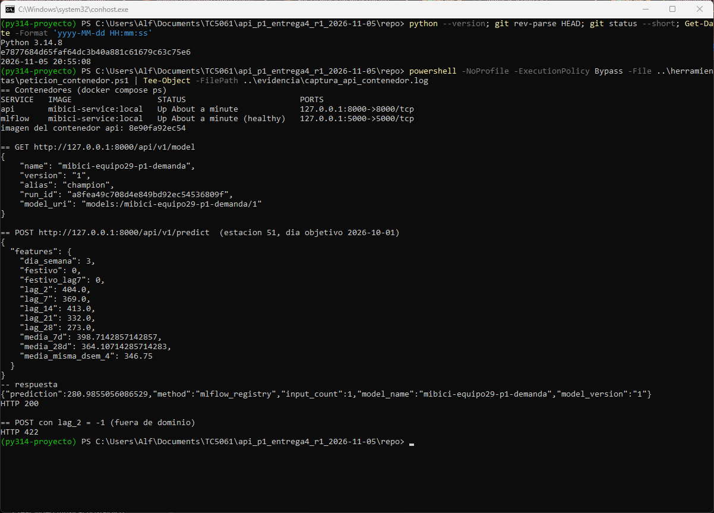

La captura es de la corrida del 5 de noviembre de 2026 con el commit `e787768`; `mibici/api` no cambió después.

#### 4. Estrategia de despliegue y límites

- Para cambiar de modelo, el flujo de P1 registra una versión nueva y sólo mueve `champion` después de cargarla y validar una predicción; luego se reinicia el servicio `api`. Para volver atrás se fija `P1_MODEL_URI` a la versión anterior en `compose.yaml` o en un `compose.override.yaml`: el valor está escrito en el archivo, así que definir la variable en la terminal no basta. Con una versión fija, `/api/v1/model` reporta `alias` nulo. Si el campeón cambia o se fija una versión, hay que actualizar `campeon_api_p1.json`; mientras tanto el recorrido falla, a propósito.
- El Registry de este Compose es una copia local del almacén de la Entrega 2, no un Registry compartido.
- La imagen parte de `python:3.14-slim` sin digest, y `fastapi` y `uvicorn` van con rangos en `requirements-api.txt`. Por eso la versión de parche de Python y la de FastAPI pueden cambiar entre máquinas y construcciones. Las que importan para el modelo (mlflow, scikit-learn, pandas, numpy, skops y cloudpickle) están fijadas igual que en el `requirements.txt` del modelo, y el recorrido lo comprueba.
- La política de dominio de P1 (predicciones de validación finitas y no negativas) se agregó después de ver resultados de prueba, así que el `test_mae` de este campeón (6.28) no es una medición con TEST intacto.

### P3 en el contenedor: grupo de uso de cada estación

La API carga el campeón de P3, `models:/mibici-equipo29-p3-grupos@champion` (configurable con `P3_MODEL_URI` en `compose.yaml`), resuelve el alias a su versión fija igual que P1 y asigna a cada estación uno de los grupos de uso del modelo. P1 y P3 se cargan por separado: si uno falla, el otro se sigue sirviendo y `/ready` responde 503 con el modelo que falta.

#### 1. Registrar el campeón de P3 en el MLflow del Compose

Si el Registry del Compose ya tiene `mibici-equipo29-p3-grupos@champion` con artefactos `mlflow-artifacts:/`, no hace falta nada más. Si no, se registra entrenando P3 contra el servidor del Compose. `train_p3` usa `tracking.configurar_experimento`: con una URI `http://` el experimento nuevo guarda sus artefactos en `mlflow-artifacts:/` y el contenedor de la API los puede leer; con la URI SQLite local nada cambia. Se necesitan los perfiles de `data/interim` (`python -m mibici.features_p3`, ver la sección de P3). Desde la raíz del repositorio:

```powershell
docker compose up -d mlflow
python -m mibici.modeling.train_p3 --model seleccion --tracking-uri http://localhost:5000
```

Es el flujo completo de selección de P3 (búsquedas, candidatas, campeón y retador) y tarda unos dos minutos. Termina con `carga por models:/mibici-equipo29-p3-grupos@champion OK`. Con los perfiles de `data_version` `66dd3d190bba` y la semilla 42, el campeón vuelve a ser `p3-kmeans-uso-k3` (C2).

#### 2. Levantar y probar

```powershell
docker compose up -d --build api
curl.exe http://localhost:8000/api/v1/p3/model
curl.exe -X POST http://localhost:8000/api/v1/p3/predict -H "Content-Type: application/json" --data-binary "@scripts/p3/ejemplo_p3.json"
```

En bash, `curl` en lugar de `curl.exe`. También se puede probar desde `http://localhost:8000/docs`, que ya trae el ejemplo. `scripts/p3/ejemplo_p3.json` es una petición real: la estación 51 con su perfil del periodo de evaluación (mayo a septiembre de 2026, `data/interim/p3_perfiles_evaluacion.parquet`), redondeado a 4 decimales:

```json
{
  "stations": [
    {
      "station_id": "51",
      "features": {
        "log_trips_day": 5.7487,
        "weekend_share": 0.2622,
        "net_am": -0.4885,
        "net_pm": 0.3124,
        "dep_am": 0.3048,
        "dep_pm": 0.281,
        "dep_mid": 0.2113,
        "dep_night": 0.1137,
        "arr_am": 0.0904,
        "arr_pm": 0.4629,
        "arr_mid": 0.2306,
        "arr_night": 0.1018
      }
    }
  ]
}
```

Respuesta del contenedor:

```json
{"assignments": [{"station_id": "51", "group": 2, "group_name": "mucho uso"}], "method": "mlflow_registry", "input_count": 1, "model_name": "mibici-equipo29-p3-grupos", "model_version": "3"}
```

Es el mismo grupo que da el modelo de esa versión cargado fuera del contenedor, con el perfil exacto y con el redondeado. El número de versión depende de cuántas veces se haya registrado P3 en ese MLflow: cada corrida de la selección registra dos versiones nuevas (campeón y retador). En la captura, la selección se corrió dos veces en volúmenes nuevos, así que `champion` es la versión 3; `GET /api/v1/p3/model` la reporta junto con su run. Con el almacén sembrado de la Entrega 2 (sección de P1), el campeón de P3 es la versión 1 (run `fd704e3c…`) y asigna el mismo grupo a la estación 51.

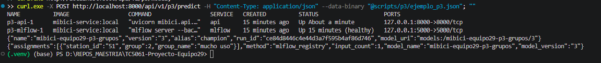

#### 3. Qué sirve la API

- `POST /api/v1/p3/predict` recibe de 1 a 1000 estaciones; cada una con un `station_id` opcional y las 12 variables de uso de `CONFIG_P3.prioridad_variables`, las mismas que calcula `mibici.features_p3.perfil_estaciones`. El modelo elige internamente cuáles usa (selección por VIF), así que siempre recibe las 12. Devuelve, en el mismo orden, el grupo, su nombre, el modelo y la versión.
- `GET /api/v1/p3/model` reporta nombre, versión, alias, run y URI inmutable.
- Validación de la entrada (si no cumple, 422 sin llamar al modelo): proporciones entre 0 y 1; `net_am` y `net_pm` entre -1 y 1; `log_trips_day` no negativo; las proporciones de salidas por franja suman a lo más 1, igual que las de llegadas (las franjas no cubren las 10 y 16 h); números como número y no como texto; sin NaN, sin campos extra ni faltantes, y `station_id` corto y sin caracteres especiales.
- Validación de la salida: si el modelo devuelve grupos no enteros, negativos o en otra cantidad, la API responde 500 con el detalle en lugar de una asignación inválida.
- Los nombres de los grupos salen de `data/grupos_interpretabilidad.csv` del mismo run que la versión cargada, así que cambian junto con ella. Si esa tabla no se puede leer, la API asigna el grupo y devuelve `group_name` nulo.

#### 4. Estrategia de despliegue

P3 se sirve como **inferencia por lotes con consulta en línea**:

- El perfil de una estación resume meses de viajes (P3 pide al menos 60 días activos), así que su grupo no cambia de un viaje a otro y no tiene sentido calcularlo por evento. El uso principal es por lotes: al recalcular los perfiles (por ejemplo, cada mes, o cuando abren estaciones nuevas, como las 84 que abrieron entre mayo y agosto de 2026), se envían todas las estaciones en una sola petición (las 453 del periodo de evaluación caben en una) y se guarda la asignación.
- La misma API responde en línea a una estación a la vez, por ejemplo para consultar el grupo de una estación nueva en cuanto cumple los días mínimos o para que un tablero lo pida al abrirse.
- Para cambiar de versión, la selección de P3 registra versiones nuevas y sólo mueve `champion` después de cargar cada una y comprobar su predicción; luego se reinicia el servicio `api`. Para volver atrás se fija `P3_MODEL_URI` a la versión anterior en `compose.yaml`.


### P2 en el contenedor: riesgo horario de ocupación

La API carga el campeón de P2, `models:/mibici-equipo29-p2-riesgo@champion` (configurable con `P2_MODEL_URI` en `compose.yaml`), resuelve el alias a su versión fija igual que P1 y clasifica el riesgo de ocupación de cada estación a t+1: `segura`, `sin_bicicletas` o `sin_anclajes`. P1, P2 y P3 se cargan por separado: si uno falla, los demás se siguen sirviendo y `/ready` responde 503 con el modelo que falta.

El modelo publicado cubre el horizonte de 1 hora. La API no calcula el panel: recibe las 18 variables de `features_p2.FEATURES` ya armadas, incluidas las estadísticas de entrenamiento.

#### 1. Registrar el campeón de P2 en el MLflow del Compose

Si el Registry del Compose ya tiene `mibici-equipo29-p2-riesgo@champion` con artefactos `mlflow-artifacts:/`, no hace falta nada más. Si no, se registra entrenando P2 contra el servidor del Compose. `train_p2` usa `tracking.configurar_experimento`: con una URI `http://` el experimento nuevo guarda sus artefactos en `mlflow-artifacts:/` y el contenedor de la API los puede leer; con la URI SQLite local nada cambia. Se necesitan el panel y el manifiesto de P2 (`python -m mibici.features_p2`, ver la sección de P2). Desde la raíz del repositorio, un entrenamiento acotado a un nivel:

```powershell
docker compose up -d mlflow
python -m mibici.modeling.train_p2 --niveles 0.5 --tracking-uri http://localhost:5000
```

Es el flujo de P2 sobre ese recorte y tarda según la máquina. Termina registrando el campeón con el alias `champion` (salvo que se pase `--no-registrar`).

#### 2. Levantar y probar

```powershell
docker compose up -d --build api
curl.exe http://localhost:8000/api/v1/p2/model
curl.exe -X POST http://localhost:8000/api/v1/p2/predict -H "Content-Type: application/json" --data-binary "@scripts/p2/ejemplo_p2.json"
```

En bash, `curl` en lugar de `curl.exe`. También se puede probar desde `http://localhost:8000/docs`, que ya trae el ejemplo. `scripts/p2/ejemplo_p2.json` es una petición que cumple el contrato (estación 51, hora 8 de un miércoles). Los valores ilustran el formato; para una predicción operativa hay que calcular las características con `mibici.features_p2`:

```json
{
  "stations": [
    {
      "station_id": "51",
      "features": {
        "hora": 8,
        "dia_semana": 2,
        "fin_semana": 0,
        "capacidad": 15,
        "ocupacion_actual": 0.47,
        "neto_lag1": 2.0,
        "neto_lag24": -1.0,
        "neto_lag168": 3.0,
        "salidas_lag1": 4,
        "llegadas_lag1": 6,
        "neto_media3": 1.0,
        "neto_media24": 0.2,
        "neto_media168_misma_hora": 1.5,
        "ocupacion_lag24": 0.4,
        "ocupacion_lag168": 0.53,
        "est_tasa_sin_bicis": 0.08,
        "est_tasa_sin_anclajes": 0.05,
        "est_neto_medio_hora": 0.4
      }
    }
  ]
}
```

Respuesta (forma; la clase sale del campeón cargado):

```json
{"predictions": [{"station_id": "51", "risk_class": "segura"}], "method": "mlflow_registry", "input_count": 1, "model_name": "mibici-equipo29-p2-riesgo", "model_version": "1"}
```

La captura de la petición y la respuesta desde el contenedor queda en `reports/figures/p2_api_contenedor.png` después de correr este flujo en local.

#### 3. Qué sirve la API

- `POST /api/v1/p2/predict` recibe de 1 a 1000 estaciones; cada una con un `station_id` opcional y las 18 variables de `features_p2.FEATURES`, en ese orden. Devuelve, en el mismo orden, la clase de riesgo, el modelo y la versión. No incluye probabilidades: el cargador compartido es pyfunc y no expone `predict_proba`.
- `GET /api/v1/p2/model` reporta nombre, versión, alias, run y URI inmutable.
- Validación de la entrada (si no cumple, 422 sin llamar al modelo): `hora` de 6 a 23; `dia_semana` de 0 a 6; `fin_semana` en 0 o 1 y coherente con el día (1 sólo si es sábado o domingo); `capacidad` entera y positiva; `salidas_lag1` y `llegadas_lag1` enteros no negativos; `neto_lag1` igual a llegadas menos salidas de la hora previa; ocupaciones y tasas no nulas entre 0 y 1; las dos tasas históricas suman a lo más 1. Pueden ir nulas (la clave va en el cuerpo) las estadísticas de estación (`est_*`) y los rezagos largos (`neto_lag24`, `neto_lag168`, `neto_media168_misma_hora`, `ocupacion_lag24`, `ocupacion_lag168`), que el modelo trata como valores faltantes. Números como número y no como texto; sin NaN, sin campos extra ni faltantes, y `station_id` corto y sin caracteres especiales.
- Validación de la salida: si el modelo devuelve una clase que no sea `segura`, `sin_bicicletas` o `sin_anclajes`, o una cantidad distinta de estaciones, la API responde 500 con el detalle en lugar de una predicción inválida.

#### 4. Estrategia de despliegue

P2 se sirve como **inferencia en línea o por micro-lotes horarios**:

- El uso principal es rebalancear antes de t+1: el operador (o un tablero) envía el panel de las estaciones que le interesan al cerrar la hora actual y recibe la clase de riesgo de la hora siguiente. Un lote de hasta 1000 estaciones cabe en una petición.
- La misma API responde en línea a una estación a la vez, por ejemplo para consultar el riesgo de una estación concreta al abrir un tablero.
- No tiene sentido invocarla por cada viaje: las características son horarias y el horizonte publicado es de 1 hora.
- Para cambiar de versión, el entrenamiento de P2 registra versiones nuevas y sólo mueve `champion` después de cargar cada una y comprobar su predicción; luego se reinicia el servicio `api`. Para volver atrás se fija `P2_MODEL_URI` a la versión anterior en `compose.yaml`.

### Consideraciones

- La base y los volúmenes de este Compose son persistentes, pero **locales a una máquina**. No constituyen todavía un Registry compartido entre integrantes; para eso MLflow y su base de datos/almacén de artefactos deben alojarse en infraestructura accesible por todo el equipo.
- Las versiones existentes cuyos artefactos apuntan a `file:///...` no se convierten al cambiar la configuración del servidor. Se debe crear y verificar una versión nueva.
- El uso de `--host 0.0.0.0` es interno a la red de contenedores; el puerto del host está limitado a loopback. Esta configuración de desarrollo no incluye autenticación y no debe exponerse como servicio multiusuario o de producción. Consulta [seguridad_p1.md](docs/seguridad_p1.md).
- Los volúmenes sobreviven a `docker compose down`. No uses `docker compose down -v` salvo que quieras borrar también los datos locales de MLflow.
- P1, P2 y P3 ya están en la API, cada uno con su ruta, esquema, servicio, variable de URI y cargador en `mibici/api/main.py`.

## Flujo de trabajo con Git

Seguimos GitHub Flow:

- `main` está protegida: todo cambio entra por Pull Request revisado por otro integrante.
- Ramas: `<versión>_<iniciales>-<descripción>`, por ejemplo `2.0_cg-p2-clasificacion` o `4.0_ab-p1-regresion`.
- Commits: [Conventional Commits](https://www.conventionalcommits.org/es/v1.0.0/) con la forma `tipo(alcance): descripción` (`feat`, `fix`, `docs`, `test`, `refactor`, `build`, `style`).
- Cada integrante abre al menos un Pull Request y revisa al menos uno de otro integrante.
- No se versionan datos de MiBici, `mlruns/`, `mlartifacts/`, `mlflow.db`, archivos `.env` ni modelos serializados (`.gitignore`).
- Los notebooks son sólo de exploración y siguen la convención `número-iniciales-descripción.ipynb`; la lógica final vive en el módulo `mibici`.

## Integrantes

| Integrante | Usuario de GitHub | Rol |
| --- | --- | --- |
| Ulises Orozco | xAlucardzx | Ingesta, preparación de datos y exploración inicial |
| Alan Alfonso Boldo Reyes | a01840556 | P1: regresión de demanda diaria por estación |
| Carlos Galván | carloshgalvan95 | P2: clasificación de riesgo por estación |
| Félix Beltrán | felixbeltranr | P3: clustering de estaciones; estructura inicial con ccds |

## Organización del proyecto

```
├── Makefile           <- Comandos de conveniencia
├── README.md
├── data               <- No se versiona
│   ├── external
│   ├── interim        <- Paneles intermedios (p. ej. p1_panel_diario.parquet)
│   ├── processed      <- combined_dataset.parquet
│   └── raw            <- CSV originales de MiBici
├── docs
├── models             <- Modelos serializados (fuera de git)
├── notebooks          <- Exploración: número-iniciales-descripción.ipynb
├── pyproject.toml     <- Metadatos del paquete y configuración de Ruff
├── references         <- ML Canvas del equipo, diagrama de arquitectura y manifiesto de datos
├── reports
│   └── figures        <- Figuras y resultados del experimento base
├── requirements.txt   <- Dependencias con versión fija
├── tests              <- Pruebas con pytest
└── mibici             <- Código del proyecto
    ├── config.py      <- Rutas, rango de datos, cortes y semillas
    ├── dataset.py     <- Ingesta: descarga, normalización y parquet combinado
    ├── features.py    <- P1: panel estación-día y variables
    ├── features_p2.py <- P2: panel horario y etiqueta de riesgo
    ├── features_p3.py <- P3: perfiles de uso por estación
    ├── manifiesto_p2.py <- Manifiesto con SHA256 y registros de cada archivo
    ├── tracking.py    <- Convención de MLflow de P1
    ├── plots.py
    └── modeling
        ├── train_p1.py
        ├── train_p2.py
        ├── train_p3.py
        ├── train.py
        └── predict.py
```
